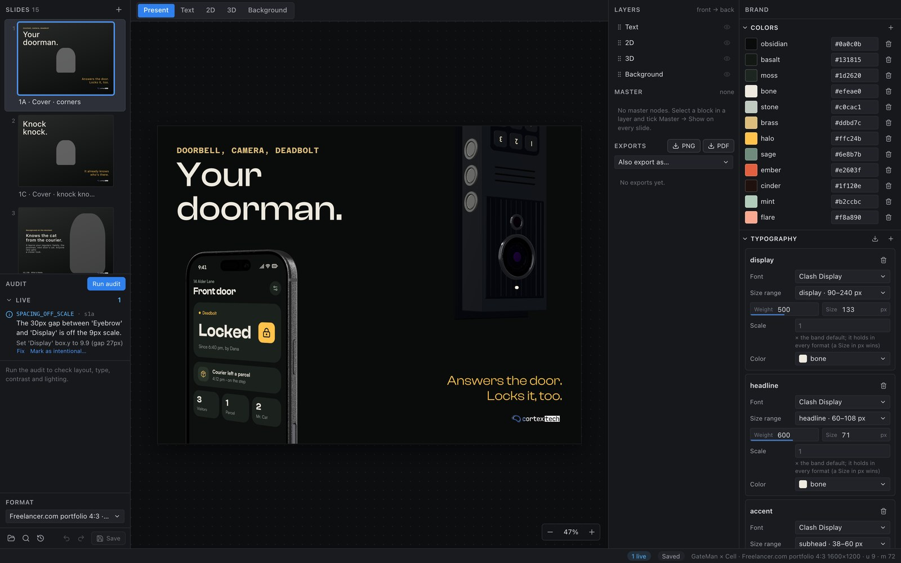
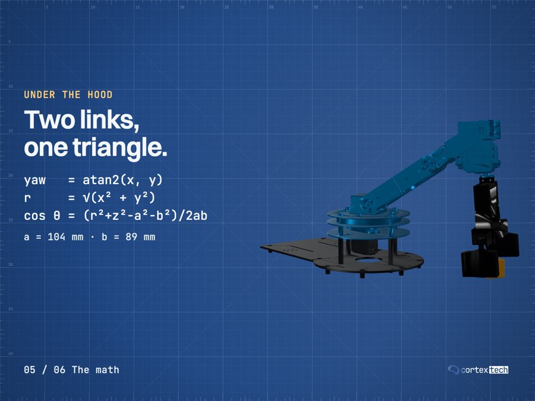
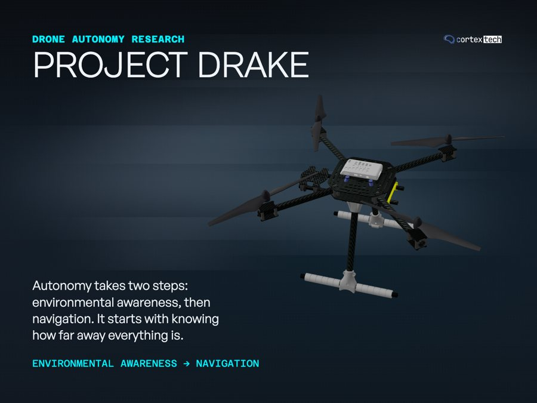
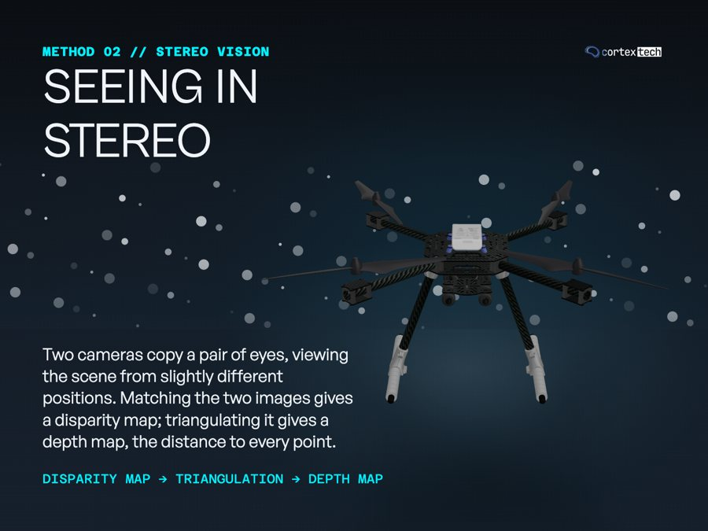
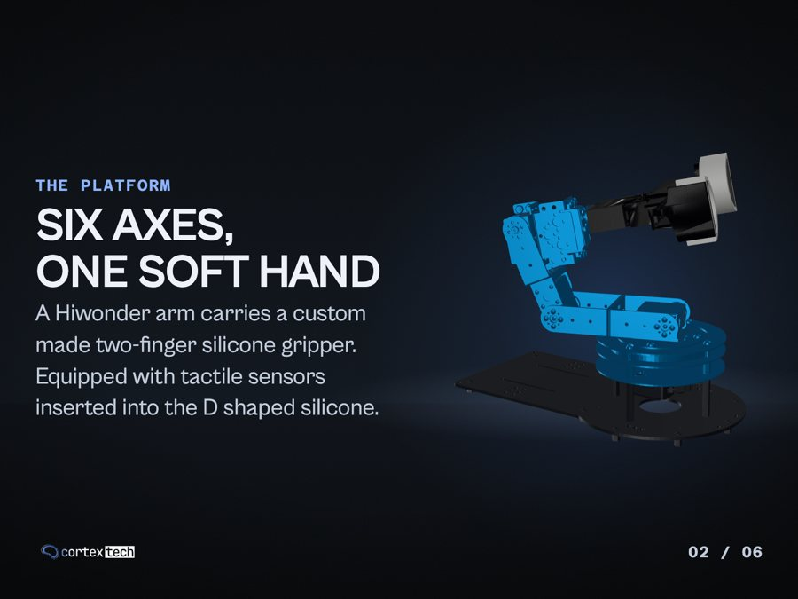
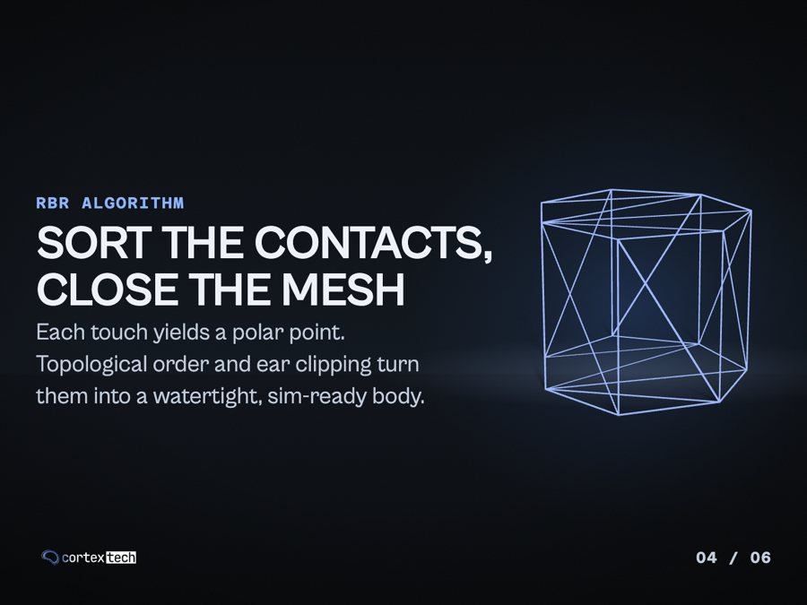
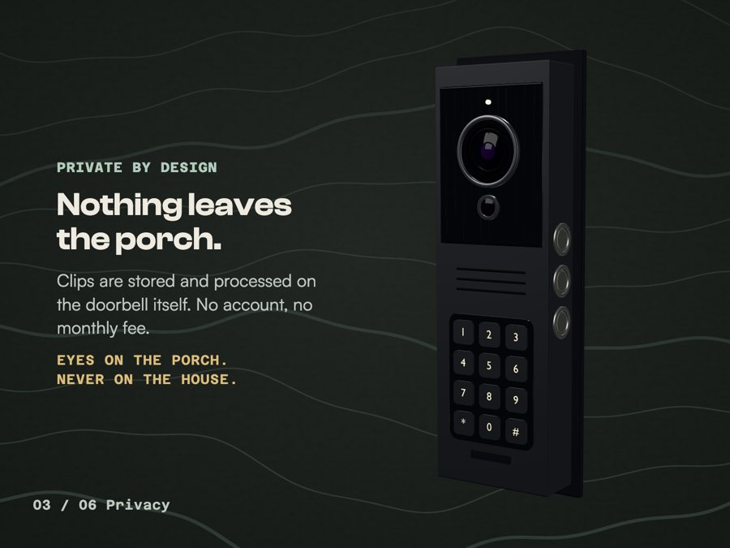
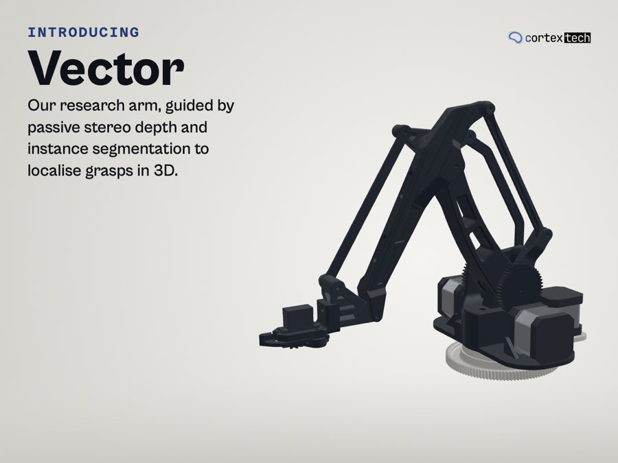
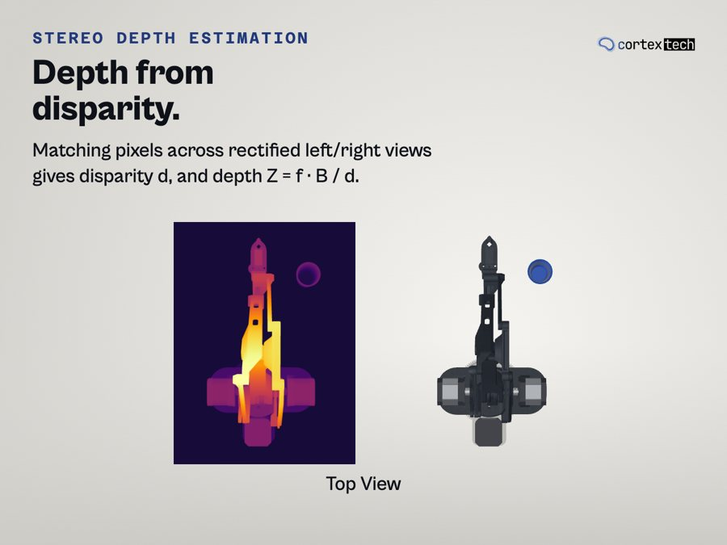
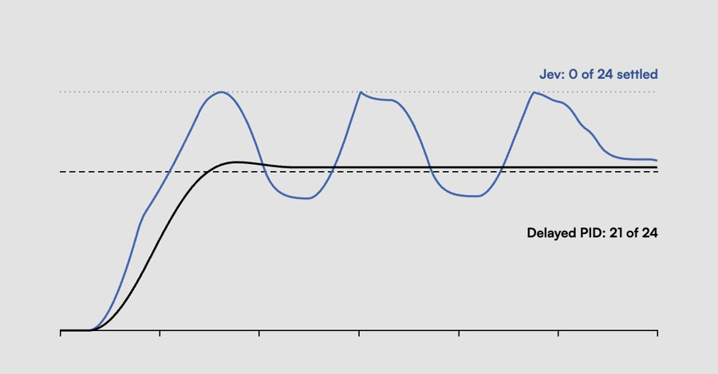

<h1 align="center">XDS</h1>

<p align="center">
  <b>A local design editor for social-media graphics that people and AI agents both drive.</b><br>
  Live 3D product scenes, typography that fits itself, and design rules that check your work while you edit.
</p>

<p align="center">
  
</p>

## What it is

Most graphic tools make you place everything by hand, one format at a time. XDS works differently:

- **Say where things go, not their coordinates.** "Pinned to the left margin", "a gap under the headline".
  One source renders correctly in Instagram, LinkedIn or any custom size.
- **Real 3D, lit for you.** Drop in a product model (a phone, a laptop, a robot) and it gets studio
  lighting automatically. Put your own app screens on the device's display.
- **A design reviewer built in.** Rules for spacing, contrast, type sizes and alignment run live.
  Each problem comes with a fix you apply in one click, or with `xds fix`.
- **Built for AI agents too.** A project is a plain folder of JSON, SVG and assets. An agent like
  Claude Code or Codex can build a whole carousel through the CLI, and you can open it in the
  editor and keep going.
- **Expressive type.** Skew, outlines, extrusion, repeats and plates, drawn by the renderer and
  checked for coherence.
- **Safe to experiment.** Start from a library of layouts; every big save leaves a snapshot to restore.

Everything runs on your machine. No account, no cloud.

## Showcase

Carousels made with XDS for cortextech projects. Every slide is a live
3D scene plus type, exported straight from the CLI.

| | |
| --- | --- |
|  |  |
| **ArmXCell**: a robot arm driven from an iPhone | **Drake**: drone autonomy research |
|  |  |
| Particles and depth in the same scene | **DarkBotX**: a robot hand that grips by touch |
|  |  |
| Wireframe geometry as a design element | **GateMan**: device plus app screen on one slide |
|  |  |
| **Vector**: a research arm, light theme | Diagrams and figures beside the 3D |

<p align="center"><br>
<sub>Not everything needs 3D: a flat blog cover in a 1200×627 format.</sub></p>

## How it works

A slide is a stack of layers: a 2D **background** (SVG), a **3D** scene, 2D **images** and drawn
**ornaments**, and **type**. You write a layout as relations (a block pinned to the margin, stacked
under another, in a column that flows), so the same slide reflows to every format. The design rules
run live in the editor and again in `xds audit`; a finding's fix is just a field write.

A project is an ordinary folder (`project.json` plus designs, assets and fonts), and the editor is a
view over those files. See [docs/](./docs/README.md) for the architecture, data models and rules.

## Setup

Requirements: [uv](https://docs.astral.sh/uv/), Node.js ≥ 20 with npm, macOS or Linux.

```bash
uv sync                                  # Python 3.12 + the xds package
npm install                              # the studio and the screen toolkit
uv run playwright install chromium       # the renderer
npm run build                            # the studio, served by `xds` for headless renders
```

Optional: the iPhone and MacBook device models are third-party and not in the repo. To use
them, set them up locally as described in [xds/library/models/AGENTS.md](./xds/library/models/AGENTS.md)
(or ask your coding agent to).

Then put `xds` on your PATH, so it works from inside a project folder. The project's `AGENTS.md`
tells agents to run plain `xds` there and never leave the project:

```bash
uv tool install --editable . --force     # `xds` everywhere, running this checkout
```

## Quickstart

```bash
uv run xds init ~/xd-projects/launch --name "Launch" --format instagram-portrait
uv run xds open ~/xd-projects/launch     # the editor (API :8765, Vite :5173)
```

Or work like an agent, through files and the CLI (the project's `AGENTS.md` explains the loop):

```bash
uv run xds guide ~/xd-projects/launch    # margins, spacing unit, type sizes for this format
uv run xds layout apply ~/xd-projects/launch hero-left --mode new   # a slide from a layout (relations, no coordinates)
# edit project.json, designs/, screens/
uv run xds check ~/xd-projects/launch    # schema + references, no browser
uv run xds measure ~/xd-projects/launch  # where the text lands (lines, heights, stacks), no 3D
uv run xds audit ~/xd-projects/launch    # render + measure + design rules
uv run xds fix ~/xd-projects/launch      # apply the findings' structured fixes
uv run xds export ~/xd-projects/launch   # audit gate → export/<stamp>/*.png (--pdf: one PDF)
uv run xds export ~/xd-projects/launch --format linkedin-landscape   # the same deck in another format
```

## CLI reference

<details>
<summary>All commands</summary>


Every command accepts `--json` (one JSON document on stdout; progress goes to stderr). Exit
status is 0 on success, 1 on failure or open audit errors.

| Command | What it does |
| --- | --- |
| `xds init PROJECT [--name NAME] [--format PRESET \| --size WxH] [--layout ID]` | create a project from the blank template (`--size`: a custom size, no platform preset; `--layout`: seed the first slide from a layout) |
| `xds open [PROJECT] [--port N] [--no-open] [--no-vite]` | start the editor; without a project it opens the project browser |
| `xds check PROJECT` | schema, references and design manifests (no browser) |
| `xds guide PROJECT [--slide ID]` | the design numbers for the format; `--slide` adds measured values |
| `xds rules [--project PROJECT]` | every audit rule with its principle and thresholds |
| `xds layout list` · `xds layout show ID` | the shipped slide layouts (written in relations, right in every format) and one layout's slots |
| `xds layout apply PROJECT ID [--slide ID] [--mode fill\|replace\|new] [--add-roles] [--dry-run]` | apply a layout: re-place the slide's text by level (`fill`), replace its 2D nodes, or add a slide after it |
| `xds measure PROJECT [--slide ID]…` | text layout without the 3D: each block's lines, ink extent, needed box height, stacked position and contrast minimum, plus the text-only audit rules; seconds for a deck |
| `xds render PROJECT [--slide ID] [--format PRESET]` | slide PNGs + contact sheet into `cache/<hash>/` |
| `xds audit PROJECT [--slide ID] [--format PRESET]` | render + measure + rules → `audit.json` + annotated PNGs |
| `xds fix PROJECT [--slide ID]… [--rule RULE]… [--severity error\|warn\|info] [--dry-run]` | apply the audit's structured fixes (each finding's `edits`) to `project.json` in one validated write |
| `xds export PROJECT [--out DIR] [--force] [--pdf] [--format PRESET]` | audit gate → slide PNGs, or with `--pdf` the deck as one PDF, in `export/<stamp>/` (`--force` is recorded). `--format` on render, audit and export works on a **target**: the source reflowed to that preset under `cache/targets/`, exported to `export/<stamp>-<preset>/` |
| `xds reflow PROJECT (--format PRESET \| --size WxH) [--dry-run]` | retarget the project itself: boxes relative to the margins, type sizes to the new bands; relations, scales and gaps are kept |
| `xds reflow PROJECT --check [--format PRESET]` | the fluidity check: reflow to one preset per orientation class, run the text-only rules, print what breaks |
| `xds snapshot PROJECT [--label TEXT]` · `--list` · `--delete ID` | a restorable copy of `project.json`, `designs/` and `screens/` in `.snapshots/` (also taken before a big save); list them; delete one |
| `xds restore PROJECT ID` | put a snapshot back; the current state is snapshotted first |
| `xds migrate [PROJECT \| --all] [--dry-run] [--conform]` | upgrade project files to the current schema, and the project's `AGENTS.md` to this version's guide |
| `xds model add PROJECT FILE --id ID [--name NAME] [--slide ID] [--replace] [--height M \| --scale F] [--front DIR] [--ground]` | check, convert (`.gltf`, `.dae`) and register a model; `--height`/`--front` bring it to real size, facing +Z, standing on its bottom center |
| `xds model inspect FILE` | parts, clips, screen meshes, convention warnings |
| `xds model library` | the device models set up locally (iPhone 17 Pro, MacBook Pro 14″; see `xds/library/models/AGENTS.md`) |
| `xds model add PROJECT --library ID [--slide ID] [--screen ID]` | use a library model by reference (not copied) |
| `xds model vendor PROJECT ASSET_ID` | copy a library model into the project so it travels without xds |
| `xds logo library` · `xds logo add PROJECT LOGO` | the cortextech logos that ship with xds · register one as an asset by reference |
| `xds screen add PROJECT ID [--device PRESET \| --width W --height H --scale S] [--landscape [left\|right]]` | create a device-screen page (`--landscape`: for the device on its side) |
| `xds screen render PROJECT ID` | render a screen page to PNG to check it flat |
| `xds design add PROJECT STARTER` | copy a starter background (`sweep`, `spotlight`, `aurora`, `grain-solid`, `split-tone`, `vignette-dark`) |
| `xds fonts fetch PROJECT FAMILY` | use a Fontshare family: downloaded once into the xds font library, referenced by the project |
| `xds fonts library` · `xds fonts vendor PROJECT [FAMILY]` | the downloaded families · copy a project's fonts into its own `fonts/` |
| `xds grid PROJECT FILE [--step PCT]` | a copy of an image with a labeled % grid (in `cache/grid/`), to read positions off it |
| `xds formats` | the format catalog, with each preset's aspect and orientation class |
| `xds schema --emit-types \| --check` | regenerate or check `packages/protocol/src/generated/project.ts` (development; `--emit-types` runs only inside this checkout) |
| `xds clean PROJECT` | delete `cache/` |

</details>

The projects directory (for the editor's project browser and `migrate --all`) is
`~/xd-projects/`, or `$XDS_PROJECTS_DIR`.

## Development

```bash
uv run pytest                 # Python tests (the render smoke test needs a built studio + Chromium)
npm test                      # vitest: editor-core and the studio
npm run typecheck
uv run xds schema --emit-types   # after changing xds/models.py (schema --check verifies)
```

Repository layout: `xds/` is the Python package (schema, gate, API, CLI, renderer, audit),
`apps/studio/` the React editor and render page, `packages/protocol/` the generated TypeScript
types, and `packages/editor-core/` pure editing math. Details are in
[docs/architecture.md](./docs/architecture.md).


## License

The code is licensed under the [Apache License 2.0](./LICENSE). Logos, the showcase images and the
device models are not covered; see [NOTICE](./NOTICE).
