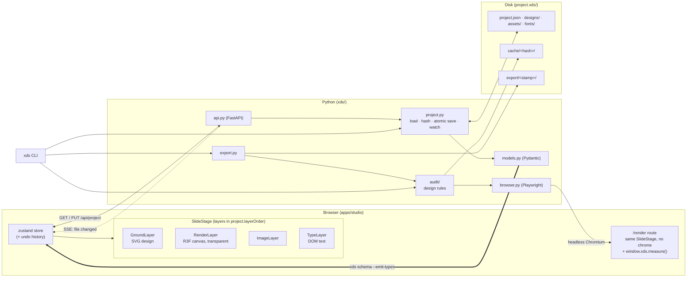
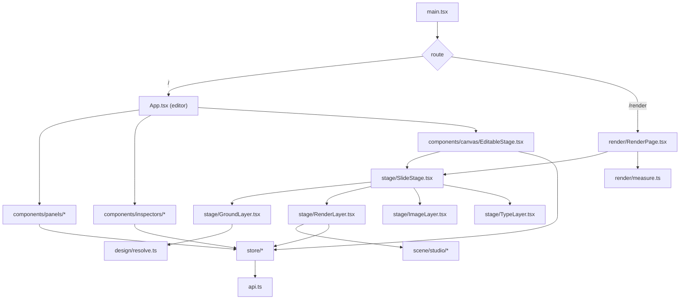

# XDS architecture

XDS is a local design editor for social-media graphics. Each slide stacks four layers: a 2D
**Ground** (background), a live **3D** scene, 2D **images** and **type**. The result is exported
as PNG.

Everything runs on one machine: no cloud service, no database, and no LLM calls inside the
product. The persistent state is an ordinary project directory (`project.xds/`) that people and
LLM agents both edit. The editor is a view over those files, and the `xds` CLI is how an agent
renders, audits and exports without it.

Four principles shape every part:

1. **Files are the truth.** One `project.json` plus designs, assets and fonts. Everything else is
   a disposable cache keyed by a hash of those files.
2. **The browser is the only rasterizer.** The editor, the headless render, the audit
   measurements and the export are all the same page in Chromium, so they cannot disagree.
3. **One schema.** Pydantic models in Python validate files, generate the TypeScript types, and
   drive migration.
4. **Readable code over clever code.** Small modules, one job each, standard libraries for
   standard problems. A person should be able to walk the code from this page.

---

## 1. Repository layout

The workspace is an npm + uv monorepo. **npm** builds the TypeScript packages and the React app;
**uv** runs the Python package and CLI.

```text
xds/
├── README.md                      # quickstart and CLI reference
├── package.json                   # npm workspaces: apps/*, packages/*
├── pyproject.toml                 # uv project: the `xds` Python package
│
├── packages/
│   ├── protocol/                  # @xds/protocol: only the TypeScript types generated
│   │   └── src/generated/         #   from xds/models.py (`xds schema --emit-types`)
│   └── editor-core/               # @xds/editor-core: pure functions (node edits, box ↔ px,
│                                  #   pose math, framing math); no React, no Three
│
├── apps/
│   └── studio/                    # @xds/studio: React + Vite + R3F
│       └── src/
│           ├── App.tsx            #   editor shell
│           ├── store/             #   zustand store, one file per slice
│           ├── api.ts             #   typed fetch client + SSE subscription
│           ├── stage/             #   the slide: <SlideStage> renders the layers in layerOrder
│           │   ├── GroundLayer.tsx  ImageLayer.tsx  TypeLayer.tsx
│           │   └── RenderLayer.tsx  #  the R3F <Canvas>
│           ├── scene/studio/      #   lighting looks, shadows, subject bounds, auto-framing
│           ├── design/            #   ground design resolution (expressions, loops, colors)
│           ├── render/            #   /render route: chrome-less <SlideStage> + measure()
│           └── components/        #   panels, inspectors, command palette
│
├── xds/                           # Python package
│   ├── cli.py                     #   `xds` entry point (argparse)
│   ├── api.py                     #   FastAPI app: routes only, no logic
│   ├── models.py                  #   Pydantic models = the schema
│   ├── project.py                 #   load, hash, save (atomic), file watching
│   ├── designs.py                 #   design manifest parsing + expression checks
│   ├── formats.py                 #   format profiles: sizes, view widths, safe zones, bands
│   ├── models3d.py                #   GLB inspection, .gltf/.dae → .glb conversion, `xds model add`
│   ├── library.py                 #   the shipped models and logos (`xds:` asset paths)
│   ├── library/models/<id>/       #   library models: model.glb + model.json
│   ├── library/brands/<id>/       #   brand logos: SVGs (+ PNG copies) + brand.json
│   ├── library/fonts/<Family>/    #   font library: Fontshare downloads + family.json (not committed)
│   ├── screens.py                 #   device-screen pages: Tailwind compile, render to texture PNG
│   ├── browser.py                 #   Playwright: render slides, collect measurements
│   ├── export.py                  #   audit gate → copy renders → export/<stamp>/
│   ├── migrate/                   #   conform pass + explicit version steps
│   ├── resources/                 #   files the CLI copies into projects (package data)
│   │   ├── template/              #     the blank project `xds init` copies (content-neutral),
│   │   │                          #     including AGENTS.md: the in-project guide for AI agents
│   │   ├── designs/               #     starter ground designs (`xds design add`)
│   │   └── screens/               #     starter screen page + status-bar/home-indicator partials
│   └── audit/                     #   the design-rule engine (see design-rules.md)
│       ├── engine.py  thresholds.py  contrast.py  saliency.py  annotate.py
│       └── rules/  collision.py  spacing.py  typography.py  contrast.py
│                   composition.py  subject.py
│
└── tests/                         # pytest (Python) + vitest (TS) + one Playwright smoke test
    └── fixtures/
        ├── example/               #   a fully authored example project
        └── design-expressions.json  # expression cases run by both the TS and Python parsers
```

`@xds/protocol` holds nothing but generated types, so it is the one place the TypeScript side
learns the file format. Starters and the project template belong to the Python package because
the CLI is what copies them, and they ship with it when `xds` is installed.

The `xds` CLI is the stable automation interface. The HTTP API is an internal detail between
the editor and the Python process. Editing files directly is the other supported way in.

---

## 2. The tiers



### 2.1 Browser: `apps/studio`

React 18, Vite, TypeScript, React Three Fiber and drei.

- **State.** One zustand store (`store/`), split into slices (document, selection, view, audit,
  jobs, disk; see [data models §7](./data-models.md#71-studiostate-appsstudiosrcstore)).
  Every edit is a store action. The `zundo` middleware gives undo/redo over the document. The
  document is "dirty" when it differs from the last saved copy.
- **SlideStage.** One component renders a slide: it maps `project.layerOrder` to stacked layers,
  so reordering layers is just reordering that array. The editor wraps it with selection handles,
  guides and gizmos. The `/render` route renders it bare at exact format size. **The editor
  and the export draw with the same component.**
- **RenderLayer.** An R3F `<Canvas>` with `alpha: true` that draws no background. It contains the
  studio rig (`scene/studio/`: environment lighting, contact shadow, auto-framing) and the active
  slide's render nodes. Models load with drei's `useGLTF` (Draco and Meshopt decoders
  enabled). See [lighting and backgrounds](./lighting-and-backgrounds.md).
- **GroundLayer.** Resolves a design SVG (`design/resolve.ts`: `expr-eval` for expressions,
  `culori` for OKLCH color functions, `subject.*` context from the render layer) and inlines it.
- **TypeLayer.** Plain DOM text with `@font-face` rules for the project's `fonts/`. Font loading
  is awaited with `document.fonts.load` before a slide reports ready.
- **API client.** `api.ts` wraps `fetch` with the generated types, and subscribes to
  `/api/events` (server-sent events) for file changes. It checks `apiVersion` once on load and
  refuses to run against a mismatched backend.

`packages/editor-core` holds the pure math (box ↔ px, pose conversion, framing, snapping) so it
can be unit-tested without a browser.

### 2.2 Python: `xds/`

Python 3.12, managed by uv. Dependencies, and what each is for:

| Dependency | Used for |
| --- | --- |
| `pydantic` | the schema, validation, defaults/aliases for migration, JSON Schema for TS generation |
| `fastapi` + `uvicorn[standard]` | the local HTTP API; `watchfiles` (bundled) for file-change events |
| `playwright` | headless Chromium for render, measure, audit and export |
| `pillow` + `numpy` | reading PNGs, pixel statistics, contact sheets, annotated audit images |
| `opencv-contrib-python-headless` | spectral-residual saliency for the attention rules (only `audit/saliency.py` imports it) |

Module responsibilities:

- **`models.py`** is the single description of `project.json`. Nothing else describes the format.
- **`project.py`** loads and validates a project, computes the source hash, saves atomically
  (write a temp file, `fsync`, `os.replace`), refuses a save whose `baseHash` no longer matches the
  file on disk, and watches the project for external changes.
- **`browser.py`** starts one headless Chromium per command (Playwright), opens
  `/render?slide=<id>` at `format` size with `deviceScaleFactor: 1`, waits for
  `window.xds.ready` (fonts loaded, GLBs loaded, the environment and shadows settled), takes the
  screenshot and calls `window.xds.measure()`. It writes into `cache/<hash>/`.
- **`audit/`** runs the design rules on the measurements and pixels
  ([design rules](./design-rules.md)).
- **`export.py`** runs the audit, blocks on errors (unless `--force`), and copies the rendered
  slides into `export/<stamp>/` with an `export.json` record.
- **`migrate/`** upgrades old project files ([data models §6](./data-models.md#6-migration)).
- **`models3d.py`** inspects and registers GLB files ([agent guide §3](./agent-guide.md#3-bringing-in-a-3d-model)).
- **`formats.py`** holds the format catalog and the numbers derived from a format.

FastAPI serves the built studio (`apps/studio/dist`) as static files, so headless commands need
one Python process and no Vite. `xds open` additionally starts Vite for hot reload during
development.

### 2.3 Disk: the project directory

```text
project.xds/
├── project.json        # the source: format, brand, objects, slides with their nodes
├── designs/            # source: SVG ground designs (artwork + knob manifest)
├── screens/<id>/       # source: HTML UI mockups shown on device screens
├── assets/             # source: images, SVGs, GLB models
├── fonts/              # source: font files
├── sources/            # optional, ignored by the app: .blend files, references, scripts
├── cache/<hash>/       # derived: slide PNGs, measurements, audit.json, annotated PNGs
└── export/<stamp>/     # derived: deliverable PNGs + export.json
```

The source hash covers `project.json`, `designs/`, `screens/`, `assets/` and `fonts/`. `cache/` can always be
deleted, and `export/` holds only finished deliverables.

---

## 3. How the pieces connect

### 3.1 HTTP routes

The API listens on `127.0.0.1:8765`. In development, the Vite UI runs on `:5173` and proxies
`/api` to it.

| Method | Route | Purpose |
| --- | --- | --- |
| GET | `/api/project` | the project, its designs (parsed manifests + SVG), `hash`, the gate's verdict, `apiVersion` |
| PUT | `/api/project` | save `{ project, baseHash }`; `409` if the file changed since `baseHash` |
| GET | `/api/events` | SSE stream: `changed` (with the new hash) when source files change on disk |
| GET | `/api/files/{path}` | serve a project file (assets, fonts, designs, cache, export); path-contained. An `xds:` path serves a library file |
| GET | `/api/formats` | the format catalog + `guide` numbers for a size |
| GET | `/api/projects` | list projects in the projects directory (default `~/xd-projects/`) |
| POST | `/api/projects/open` | switch the active project |
| POST | `/api/projects/init` | scaffold a new project |
| POST | `/api/projects/choose` | macOS folder picker (AppleScript) |
| POST | `/api/audit` | render + audit; streams progress lines over SSE; returns the report |
| POST | `/api/export` | audit gate + export; returns the files written |
| GET | `/api/exports` | finished exports with their `export.json` records and file links |
| GET | `/api/screens/{id}.png` | a device screen rendered to PNG (cached under `cache/<hash>/screens/`) |
| GET | `/api/starters` · POST `/api/designs/add` | starter designs, and copying one into `designs/` |
| POST | `/api/models/import` | multipart upload; runs `xds model add` |
| GET | `/api/library` · POST `/api/models/library` | the shipped models and logos, and adding a model by reference (`xds model add --library`) |
| POST | `/api/fonts/fetch` | runs `xds fonts fetch` |

Commands that change `project.json` on the server (`designs/add`, `models/import`, `fonts/fetch`)
need a saved document. The editor saves first, and the resulting file change reloads it.

Errors are `{ ok: false, error: { code, message, path?, details? } }` with `409` conflict, `422`
validation, and `404` missing.

### 3.2 The CLI

`xds/cli.py` calls the same functions as the API, so a headless agent and the editor share one
implementation. Every command accepts `--json`.

```text
xds init PROJECT [--name NAME] [--format PRESET]
xds open [PROJECT] [--port N] [--no-open]
xds check PROJECT                         # schema + references + designs (no browser)
xds guide PROJECT [--slide ID]            # the design numbers for this format
xds rules                                 # every audit rule with principle + thresholds
xds render PROJECT [--slide ID]           # slide PNGs + contact sheet → cache/<hash>/
xds audit PROJECT [--slide ID]            # render + measure + rules → audit.json + annotated PNGs
xds export PROJECT [--out DIR] [--force]  # audit gate → export/<stamp>/
xds migrate [PROJECT | --all] [--dry-run] [--conform]
xds model add PROJECT FILE --id ID [--name NAME] [--slide ID] [--replace]   # .glb, .gltf, .dae
xds model inspect FILE                    # parts, clips, screen meshes, convention warnings
xds model library                         # the device models xds ships
xds model add PROJECT --library ID [--slide ID] [--screen ID]   # reference one (not copied)
xds model vendor PROJECT ASSET_ID         # copy a library model into the project
xds logo library                          # the brand logos xds ships
xds logo add PROJECT LOGO [--id ID]       # register one as an svg asset (not copied)
xds screen add PROJECT ID [--device PRESET | --width W --height H --scale S]
xds screen render PROJECT ID              # the screen page → PNG, to check it flat
xds design add PROJECT STARTER
xds fonts fetch PROJECT FAMILY           # downloaded once into the font library, referenced
xds fonts library                         # the families already downloaded
xds fonts vendor PROJECT [FAMILY]         # copy library fonts into the project
xds formats
xds schema --emit-types | --check
xds clean PROJECT                         # delete cache/
```

The CLI, the API and the editor all read the **saved** source. None of them keeps private state.

### 3.3 Frontend module graph



All mutations go through store actions. Components never call the API directly.

---

## 4. Rendering: one path

```text
saved project.json + designs + screens + assets + fonts
  → xds/browser.py launches headless Chromium (Playwright)
  → screens/<id>/index.html → cache/<hash>/screens/<id>.png   (only the screens the slides use)
  → /render?slide=<id>  at exactly format.width × format.height
  → SlideStage draws every layer in layerOrder, the same component as the editor
  → window.xds.ready   (fonts, GLBs, environment, shadows)
  → page screenshot     → cache/<hash>/slides/<n>-<id>.png     (the final composite)
  → window.xds.measure()→ cache/<hash>/measure/<id>.json        (geometry for the audit)
  → layer passes        → per-layer alpha masks + background-only composite (for masking/contrast rules)
```

The render page exposes `window.xds` (`apps/studio/src/render/`), which `browser.py` drives:

| Member | Meaning |
| --- | --- |
| `ready` | true once fonts, GLBs, screen textures, the environment, shadows, framing and the ground (resolved with `subject.*`) are done, plus two more frames |
| `error` | a fatal error (unknown slide, invalid project); the command fails immediately |
| `waiting()` | what is still pending, e.g. `["fonts: Satoshi 700", "model: bottle"]` |
| `measure()` | the `SlideMeasure` ([data models §5.1](./data-models.md#51-slidemeasure-what-the-render-page-reports)) |
| `showLayers(layers, { background, shadows })` | show only these layers (and optionally the flat background fill and the 3D shadows); resolves once drawn |

Each layer mask is a screenshot of that layer alone, without background or shadows, so the
render layer's mask is the product's silhouette.

There is no separate per-layer capture, no compositing in Python, and no font embedding: the
screenshot *is* the composite, made the same way the person sees it in the editor. Exporting
copies these PNGs. If one slide fails to become ready within the timeout, the command fails and
names what it was still waiting for (`fonts: Satoshi 700`, `model: bottle`).

---

## 5. Safety boundaries

- **Authority.** `project.json` is the source. The editor's in-memory document becomes source only
  when saved. A 3D gesture writes a pose patch into the store when it completes, never
  continuously.
- **Mode isolation.** A mode is `present` (view-only) or one of the four layer ids, `type`
  (Text), `image` (2D), `render` (3D) and `ground` (Background), so modes and layers share one set
  of names. Store actions reject an edit to a node whose layer doesn't match the mode.
- **Rigid models.** The store has no action that writes `parts`, `animation` or `screens`. These
  belong to the file and the agent, and editor saves carry them through unchanged.
- **Freshness.** Every derived artifact lives under its source hash, so a changed source can
  never be served stale results.
- **Saves.** One file, written atomically, guarded by `baseHash`. A save either replaces the
  whole file or leaves it untouched.
- **Paths.** Every path in `project.json` is project-relative and checked to stay inside the
  project. `/api/files` serves nothing outside it.

---

## 6. 3D models and Blender

The app loads glTF binary (`.glb`) files and has **no knowledge of Blender**: no Blender
renderer, no Blender settings, no generator scripts. `.gltf` and `.dae` files are converted to
`.glb` once, on import. The editor treats a model as one rigid object. Only an agent, by editing
the file, can articulate its named parts (`RenderData.parts`, [data models §2.5](./data-models.md#25-node-the-editable-unit)). Blender (or any other tool) is how an agent
or a person *creates* a model. The [agent guide](./agent-guide.md#3-bringing-in-a-3d-model)
describes the export conventions and `xds model add`, which checks and registers a GLB.

---

## 7. Where to go next

- [Data models](./data-models.md): every schema and where it lives on disk.
- [Lighting and backgrounds](./lighting-and-backgrounds.md): the studio rig, framing, and
  product-showcase grounds.
- [Design rules](./design-rules.md): the numbers, the audit, and every rule.
- [Agent guide](./agent-guide.md): the file-and-CLI workflow, and bringing in models.
- [Human interaction](./human-interaction.md): the editor, and where a person clicks.
- [Dataflow](./dataflow.md): every input, transformation and destination.
