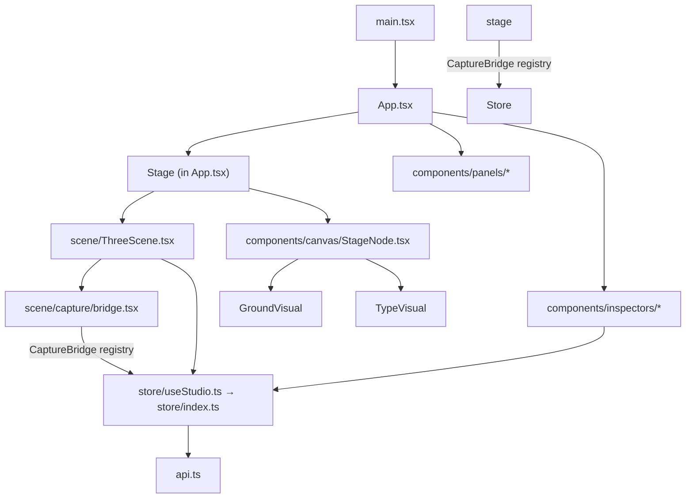

# XDS Architecture

Everything runs on one machine. There is no cloud service, no database, and no LLM call
inside the product, but projects are meant to be editable and auditable via LLMs. 
The persistent state is an ordinary directory of editable files
(`project.xds/`) on disk; the editor is a view over those files.

---

## 1. Repository layout

The workspace is an npm + uv monorepo (`@xds/workspace`).
Two package managers work side by side: **npm** builds the TypeScript
packages and the React app, **uv** runs the Python services and CLI.

```text
xds/                               # repository root (npm + uv monorepo)
├── README.md                      # user-facing quickstart and CLI reference
├── package.json                   # npm workspaces: apps/*, packages/*
├── pyproject.toml                 # uv project: xds_cli, services, workers
│
├── packages/
│   ├── protocol/                  # @xds/protocol — generated types, blank init scaffold, example project
│   └── editor-core/               # @xds/editor-core — pure reducer/transform math
│
├── apps/
│   └── studio/                    # @xds/studio — React/Vite/R3F editor
│
├── services/                      # Python backend (stdlib HTTP server)
│   ├── api/                       # HTTP surface: core.py, server.py, __main__.py (xds-api)
│   ├── project/project.py         # validation, locks, hashing, guarded save transaction
│   ├── schema.py                  # single-source rule set for the three JSON documents
│   ├── pipeline.py                # capture ingestion, review, composite, export
│   ├── audit.py                   # two-stage structural + rendered-geometry audit
│   ├── measure.py                 # browser-measured type geometry for the audit
│   ├── browser.py                 # headless capture worker (drives the Studio in Chrome)
│   ├── designs.py                 # tolerant parser for authored SVG design manifests
│   ├── migration.py               # rewrites retired pattern projects into authored designs
│   ├── renderer.py                # renderer capabilities (three vs blender)
│   ├── targets.py                 # export-target catalog + derived type sizing
│   └── blender/                   # optional headless Blender orchestration + validation
│
├── workers/
│   └── blender/render.py          # Blender worker (runs under Blender's Python)
│
├── xds_cli/                       # the `xds` command entry point
└── tests/                         # Python backend tests (schema parity/types, migration, studio, Blender smoke)
```

The stable automation boundary is the **CLI** (`xds`). The local HTTP API is an
internal, versioned detail used by the browser. Direct file editing is the other
supported entry point.

---

## 2. The three tiers

The system follows a strict three-tier architecture, driven either interactively through the Vite web app or headlessly via the CLI:

```mermaid
flowchart LR
  %% -----------------------------------------------------------
  %% Tier 1: Browser Tier
  %% -----------------------------------------------------------
  subgraph T1["1. Browser Tier (apps/studio)"]
    direction TB
    subgraph T1_Packages["Packages"]
      Protocol["@xds/protocol<br/><i>(generated types)</i>"]
      EditorCore["@xds/editor-core<br/><i>(math & reducers)</i>"]
      Protocol --> EditorCore
    end

    Store["store/index.ts + store/useStudio.ts<br/><i>In-memory editor state & pending queue</i>"]
    EditorCore --> Store

    subgraph T1_Layers["Ordered Composition Layers"]
      direction TB
      Ground["GroundVisual (DOM)"]
      Image["ImageVisual (DOM)"]
      Type["TypeVisual (DOM Text)"]
      R3F["ThreeScene (3D R3F Canvas)"]
    end

    subgraph T1_Capture["Rasterization Engine"]
      direction TB
      Overlay["scene/capture/overlay.ts<br/><i>html-to-image (DOM layers)</i>"]
      Capture["scene/capture/bridge.tsx<br/><i>WebGLRenderTarget (3D)</i>"]
    end

    Store --> T1_Layers
    Ground --> Overlay
    Image --> Overlay
    Type --> Overlay
    R3F --> Capture
  end

  %% -----------------------------------------------------------
  %% Tier 2: Local Service Tier
  %% -----------------------------------------------------------
  subgraph T2["2. Local Service Tier (services/)"]
    direction TB
    API["HTTP API Server<br/>(server.py + core.py)"]

    subgraph T2_Services["Backend Services"]
      direction TB
      PipelineService["Compositor & Pipeline<br/>(pipeline.py)<br/><i>alpha composite · contact sheet · export</i>"]
      AuditService["Inspection & Audit<br/>(audit.py + measure.py)<br/><i>structural check + geometry audit</i>"]
      ProjectService["Project & Storage<br/>(project/project.py)<br/><i>locks · atomic save · journal</i>"]
    end

    API --> PipelineService
    API --> AuditService
    API --> ProjectService
  end

  %% -----------------------------------------------------------
  %% Shared Contract & Schema Authority
  %% -----------------------------------------------------------
  subgraph SchemaTier["Single Source Rule Set"]
    direction LR
    Schema["services/schema.py<br/><i>Single-source schema validator</i>"]
  end

  %% Schema flows: straight to protocol (codegen) and straight to project validation
  Schema ==>|"uv run xds schema --emit-types"| Protocol
  Schema -->|"validates"| ProjectService

  %% -----------------------------------------------------------
  %% Tier 3: Disk Tier
  %% -----------------------------------------------------------
  subgraph T3["3. Disk Tier (project.xds/)"]
    direction TB
    subgraph T3_Artifacts["Derived Artifacts (Disposable)"]
      direction TB
      Exp["export/<hash>/<br/><i>final publication PNGs</i>"]
      Cache["cache/<br/><i>audits · renders · reviews</i>"]
      RS["review-state.json<br/><i>source-hash audit proof</i>"]
    end

    Sources["project.json & scene-data.json<br/><i>Editable Sources (Truth)</i>"]
  end

  %% -----------------------------------------------------------
  %% Orchestrator / CLI
  %% -----------------------------------------------------------
  CLI["CLI & Automation<br/>(xds open / audit / export)"]

  %% Interactions between Tiers
  CLI ==>|"boots API & Vite / runs headless"| API
  CLI -.->|"drives headless capture"| T1_Capture

  Store <==>|"GET /api/project<br/>POST /api/save"| API
  Overlay -->|"POST /api/render/overlays"| API
  Capture -->|"POST /api/render/capture"| API

  %% Direct, straight-across connections without crossing
  PipelineService -->|"certified release"| Exp
  PipelineService -->|"Ground + 3D + Type blend"| Cache
  AuditService -->|"record proof & audit cache"| RS
  ProjectService <==>|"atomic read / write"| Sources
```



### 2.1 Browser tier — `apps/studio`

A React 18 + Vite + TypeScript single-page app. It owns:

- **Editor state** — `store/types.ts` declares the whole `StudioState` (project, scene, review,
  pending edits, selection, mode, renderer); `store/index.ts` wires the slices and owns the
  singleton, and `store/useStudio.ts` exposes it to React through `useSyncExternalStore`.
- **The authoritative live 3D scene** — `scene/ThreeScene.tsx` mounts a React Three Fiber
  `<Canvas>` and reconciles `scene-data.json` into real Three.js `Object3D`s, using Drei
  `TransformControls` and `OrbitControls`. The canvas is alpha-transparent and paints no
  background of its own; the stage backdrop (`App.tsx` `.stage-paper`) supplies it, since
  capturing a transparent 3D frame is what lets it composite over the Ground layer.
- **Studio lighting** — `scene/lighting.ts` holds the five fixed rigs plus the pure knob math
  (yaw/pitch orbit, intensity, softness); `ScenePanel` drives them. A slide's rig, ambient and
  exposure are stored in the slide's own `lighting` block in `project.json`, so `scene-data.json`'s
  lights stay the authored default and a rig choice never rewrites the global scene.
- **Frame capture** — `scene/capture/bridge.tsx` rasterizes the R3F canvas to a transparent PNG
  at the publish-target size via a `WebGLRenderTarget`.
- **Layer order** — `project.layerOrder` is the composition stack (back → front) and the one place
  it is written down: the canvas stacking, the mode switcher and `pipeline._composite_frame` all
  read it. Reordering happens in Present mode (`store/actions/layers.ts`).
- **2D image layer** — an `image` node binds to an asset in `project.assets` (`kind` image/svg) and
  `ImageVisual` renders it in the DOM, so the browser stays the only rasterizer.
- **Overlay capture** — `scene/capture/overlay.ts` rasterizes each DOM layer (ground, image and
  type) with `html-to-image`, always with `skipFonts`. The library's own embedding walks every
  stylesheet in the document and inlines every format of every face it finds on *each*
  capture — measured on a real one-slide deck that was ~30 s and an 11 MB SVG per capture,
  paid even by the font-free ground layer. The Type layer instead receives the scoped CSS
  from `fonts/embed.ts`, built from the Fontshare stylesheet the project already requests,
  woff2 sources only. A font that cannot be fetched fails the capture by name; text is
  never silently rasterized in a fallback face.
- **Capture phases** — every capture times its own steps (`3D`, `ground`, `type`, `upload`)
  and publishes them as `captureProgress.detail`, so a slow render names the step it is in
  instead of showing an anonymous spinner. Headless runs collect the same lines in
  `window.__xdsCapture.phases`.
- **API client** — `api.ts` wraps `fetch` calls and types responses using generated
  protocol types from `packages/protocol`. It performs a version handshake (`REQUIRED_API_VERSION`)
  and refuses to run against an out-of-date backend. Schema validation is centralized solely
  in the Python service tier.

`packages/editor-core` supplies pure functions for node edits (`nodes.ts`), 2D/3D transform
conversion (`transforms.ts`, `scene.ts`), layer ordering (`layers.ts`), document normalization
(`normalize.ts`), and three-way rebase (`pending.ts`). `packages/protocol` is the single source of the data contract: it contains
the TypeScript declarations generated from `services/schema.py`, the blank init scaffold
(`packages/protocol/template/`) that `xds init` copies, and the designed example project
(`packages/protocol/example/`) the frontend test suite loads. The scaffold stays content-neutral
so an author or agent never anchors on pre-seeded values.

Ground is the one layered content the editor does not treat as a fixed form: the project's
`designs/` directory holds authored SVG designs, each an SVG template with its own knob manifest in
`<metadata id="xds-design">`. A ground node binds to a design by `designId` and supplies its own
`values`; `GroundVisual.tsx` hands the template to `design/resolve.ts`, which evaluates `{{ … }}`
placeholders (a param name, or an arithmetic expression over params and enclosing loop variables)
and expands `data-xds-repeat` directives, then injects the resulting artwork (the browser stays the
only ground renderer, so headless export is unchanged), and `GroundInspector.tsx` builds its
controls from the design's declared `params`. Neither the artwork nor its knobs are
validated — the design file is opaque to the gate, which only checks that the file exists
(`services/designs.py` parses the manifest tolerantly for the editor and the payload).

### 2.2 Local service tier — `services/`

Python. Exposed via a dependency-free stdlib HTTP server (`api/server.py`) behind the shared contract (`api/core.py::LocalApi`).

Responsibilities:

- **`schema.py`** — the single description of `project.json`, `scene-data.json` and
  `review-state.json` (fields, types, references, cross-field checks) plus the walker that
  validates against it. The gate and the TypeScript declarations are generated from this file;
  nothing else describes these formats.
- **`project/project.py`** — validation through `services/schema.py`, project-directory
  checking, advisory locking, SHA-256 source hashing, the guarded multi-file save
  transaction, journal recovery, and review-state management.
- **`pipeline.py`** — accepts captured frames, writes the hash-keyed render manifest,
  composes Ground → 3D → Type by alpha-blending the browser's PNGs in that fixed order,
  builds review bundles and contact sheets, and produces the final exact-size PNG export.
  It includes a dependency-free PNG codec and draws nothing itself: every pixel comes from
  the browser capture, and a manifest without ground/type overlays is rejected with
  `OVERLAY_REQUIRED` instead of being approximated.
- **`audit.py`** — the unified two-stage inspection engine: structural checks through the
  Python gate, then geometry, legibility and overlap checks that consume browser measurements.
- **`measure.py`** — stores the editor's laid-out type measurements (per slide, per node,
  keyed by source hash). The audit reports `GEOMETRY_UNMEASURED` when they are missing instead
  of approximating text layout in Python.
- **`browser.py`** — runs the headless capture worker: it starts the local API when needed
  and drives the Studio's own browser rendering (see `apps/studio/capture/`). It renders
  nothing itself and never substitutes Blender for a missing browser.
- **`designs.py`** — parses the `<metadata id="xds-design">` manifest of an authored SVG design
  for the editor and the API payload; the file stays opaque to the gate.
- **`migration.py`** — the `xds migrate` rewriter: folds retired `project.json.patterns` ground
  data into authored `designs/<patternId>.svg` files and `designId` bindings, idempotently and
  with timestamped backups.
- **`renderer.py`** — reports capabilities: Three.js runs in the browser (open editor or
  headless capture worker), Blender is optional, headless, and renders the 3D layer only.
- **`targets.py`** — the export-target catalog and the per-role type ratios derived from a
  target's shorter edge.
- **`blender/`** — the optional orchestrator that launches a Blender executable and
  validates the restricted recipe dialect. Never invoked unless explicitly selected.

### 2.3 Disk tier — the project directory

```text
project.xds/
├── project.json          # editable source: slides, nodes, brand, canvas, publishTarget
├── scene-data.json       # editable source: shared 3D catalog, camera, authored default lights
├── designs/              # editable source: authored SVG background designs (artwork + knobs)
├── project-scene.py      # OPTIONAL Blender/generic generator source
├── review-state.json     # source-hash-bound review + audit record
├── assets/               # hashed, project-contained binary assets
├── fonts/                # referenced fonts
├── cache/
│   ├── previews/         #   disposable preview frames
│   ├── renders/<hash>/   #   hash-keyed final render manifest + PNGs
│   ├── audits/<hash>.json#   immutable audit proof per source hash
│   └── reviews/<hash>/   #   1:1 frames + contact sheet
└── export/<hash>/        # exact-size PNG deliverables
```

**`project.json` and `scene-data.json` are the only editable sources.** PNG is generated
output. `review-state.json` and everything under `cache/` are derived and disposable.
A `.blend` file is never required and never source of truth.

---

## 3. How the pieces connect

### 3.1 Request routing

The browser talks to `http://127.0.0.1:8765` (API) and loads the Vite UI from
`http://127.0.0.1:5173`. `xds open` boots both processes and waits until each is
reachable before opening a browser tab.

A headless capture never takes the Studio's API port: `resolve_api_port` reuses `8765`
only when that API serves **the same project**, and otherwise takes a free port from the
capture range. The `open` supervisor likewise watches the child processes it started
instead of polling the port, so a capture passing through can neither be mistaken for the
session nor end it.

| Method | Route | Handler | Purpose |
| --- | --- | --- | --- |
| GET | `/api/project` | `LocalApi.get_project` | Current snapshot: project, scene, review, hashes, capabilities |
| GET | `/api/projects` | `LocalApi.list_projects` | Discover projects in `~/xd-projects/` (or configured directory) |
| GET | `/api/targets` | `LocalApi.targets` | Export-target catalog |
| GET | `/api/assets` | `LocalApi.list_assets` | Project asset catalog |
| POST | `/api/targets/scale` | `LocalApi.target_scale` | Derive the per-role type bands for a target size |
| GET | `/api/artifact?path=` | `LocalRequestHandler._send_artifact` | Serve a project-contained cache/export file |
| GET | `/api/asset?path=` | `LocalRequestHandler._send_project_asset` | Serve a project-contained asset binary |
| POST | `/api/project/open` | `LocalApi.open_project` | Switch active project root to a different project directory |
| POST | `/api/project/init` | `LocalApi.init_project` | Scaffold a new project via the API |
| POST | `/api/project/choose` | `LocalApi.choose_project_folder` | Prompt native macOS folder selection dialog via AppleScript |
| POST | `/api/save` | `LocalApi.save` | Guarded transactional multi-file save |
| POST | `/api/validate` | `LocalApi.validate` | Alias of audit |
| POST | `/api/audit` | `LocalApi.audit` | Run + record the unified audit |
| POST | `/api/preview` | `LocalApi.preview` | Report that the Studio R3F canvas is the preview |
| POST | `/api/render` | `LocalApi.render` | `three` → capture-required; `blender` → headless run |
| POST | `/api/render/capture` | `LocalApi.capture_render` | Ingest batch Three.js frames from browser → manifest |
| POST | `/api/render/overlays` | `LocalApi.capture_overlays` | Ingest batch Ground/Type overlay PNGs from browser |
| POST | `/api/render/frame` | `LocalApi.save_streamed_frame` | Ingest one streamed browser frame (raw upload; optional endpoint) |
| POST | `/api/blender/render` | `LocalApi.blender_render` | Explicit headless Blender render |
| POST | `/api/review` | `LocalApi.review` | Create a review bundle or set a decision |
| POST | `/api/export` | `LocalApi.export` | Audit gate, render-if-needed, write PNGs |

Errors are normalized to `{ ok: false, error: { code, message, details } }`, with HTTP
status derived from the exception type (409 conflict, 423 locked, 422 validation).

### 3.2 The CLI

`xds_cli/cli.py` maps subcommands to the same services the API uses, so a headless
agent and the GUI share one implementation:

```text
xds init PROJECT [--id ID] [--name NAME] [--force] [--json]
xds migrate [PROJECT] [--all] [--dir DIR] [--dry-run] [--json]
xds targets [--json]
xds schema [--emit-types] [--check] [--json]
xds audit PROJECT [--structural-only] [--json]
xds validate PROJECT [...]              # alias for audit
xds preview PROJECT [--json]
xds render PROJECT [--slide N] [--renderer three|blender] [--blender PATH] [--timeout N] [--save-blend] [--json]
xds measure PROJECT [--json]
xds blender-preview PROJECT [--slide N] [--blender PATH] [--timeout N] [--save-blend] [--json]
xds blender-render PROJECT [--slide N] [--blender PATH] [--timeout N] [--save-blend] [--json]
xds review PROJECT [--slide N] [--decision pending|approved|rejected] [--notes] [--json]
xds export PROJECT [--output PATH] [--json]
xds open [PROJECT] [--port N] [--web-port N] [--no-open] [--json]
```

The CLI, the HTTP API, and any future MCP wrapper all read the **current saved source**;
none of them owns a private state.

### 3.3 Frontend module dependency graph



All mutations funnel through `studioActions` (exported from `store/useStudio.ts`), which mutate
the single `store/index.ts` state. Components never write the API directly except through the
store's actions.

---

## 4. Rendering pipeline (normal path)

```text
current project.json + scene-data.json + assets
  → schema/policy validation (services/project)
  → stable scene ID map
  → R3F Canvas + recipes + assets (browser)
  → real Object3D hierarchy, camera, lights, PBR materials
  → Drei TransformControls + OrbitControls (3D mode)
  → live preview / read-only Present composite
  → semantic Object3D → SceneData pending patch
  → guarded native-file save (Cmd/Ctrl+S)
```

Final frames come from **one explicitly selected renderer**:

- **Three.js (default, in-editor):** the R3F canvas rasterizes each slide to a transparent
  PNG at the target size; the browser uploads frames to `/api/render/capture`, and Python
  writes `cache/renders/<source-hash>/manifest.json` (`renderer: "three"`).
- **Blender (optional, headless):** `workers/blender/render.py` builds a fresh scene from
  the same recipe data and writes a renderer-neutral manifest (`renderer: "blender"`).

The manifest schema is renderer-neutral (`renderPath` / `metadataPath`), so review, audit,
and export consume either renderer's output unchanged. The pipeline **never falls back**
from the selected renderer to the other.

---

## 5. Authority, isolation, and safety boundaries

- **Authority.** `scene-data.json`/`project.json` are persistent source. R3F is the
  authority for the *current, possibly unsaved* runtime scene; it serializes changes back
  as a semantic patch. Three.js never writes source continuously.
- **Mode isolation.** A mode is `present` (view-only) or one of the four layer ids — `type`
  (Text), `image` (2D), `render` (3D), `ground` (Background) — so the modes and the layers are one
  set of names, not two. Enforced in `store/index.ts` (`guardNode`, `editableLayer`) and in the
  stage, not merely by hiding controls.
- **Freshness.** Every render, review, audit, and export records the ordered SHA-256 hashes
  of the sources it used. A hash mismatch marks a result `stale`, and stale results can
  never satisfy a gate.
- **Guarded saves.** `Cmd/Ctrl+S` writes project.json, scene-data.json, and any needed
  review invalidation as one journaled transaction: validate → lock → re-check hashes →
  stage → replace → roll back on failure. It writes **all pending changes or none**.

---

## 6. Optional Blender path

Blender is a selectable headless renderer and a custom-geometry/baking/GLB tool — never the
default, editor, live preview, or a required save dependency.

- `project-scene.py` is optional for the project and Three.js rendering, but is required
  when invoking the Blender pipeline (`xds blender-preview`, `xds blender-render`, or
  `xds render --renderer blender`). It is statically inspected and executed only inside
  an isolated Blender process.

- `services/blender/validation.py` enforces a restricted recipe dialect: a small builtins
  allowlist, an AST node allowlist, no imports/lambdas/classes, and attribute access
  limited to `context.project/scene_data/slide/mode`.
- Ordinary open, watch, preview, save, validate, audit, review, and export **never** invoke
  Blender or execute `project-scene.py`.

---

## 7. Where to go next

- [Data models](./data-models.md) — every schema, and where each field lives on disk.
- [Human interaction](./human-interaction.md) — the layout and where a person clicks.
- [Dataflow](./dataflow.md) — inputs, transformations, and destinations.
