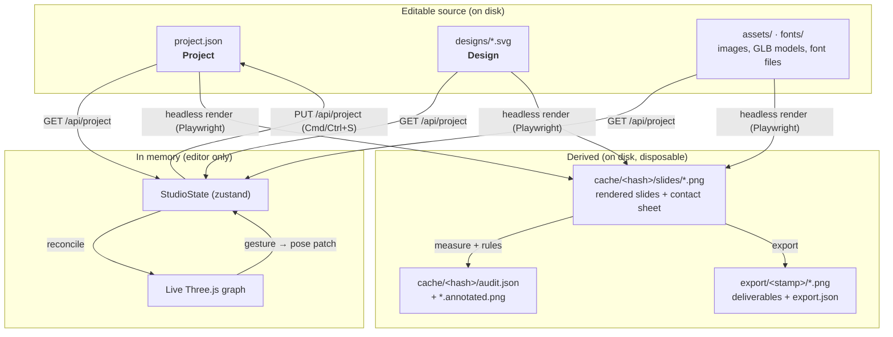
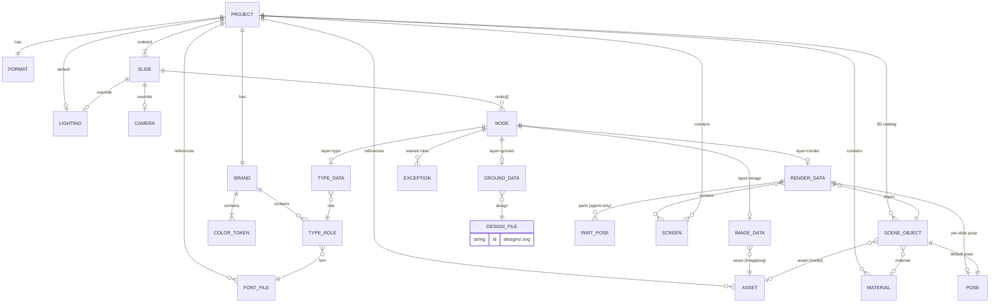

# XDS data models

**The rules live in exactly one place:** the Pydantic models in `xds/models.py`. Three
consumers read them:

1. the **gate** (`xds/project.py`), which validates `project.json` on every load, save, audit and
   export;
2. the **type generator** (`uv run xds schema --emit-types`), which turns the models' JSON Schema
   into `packages/protocol/src/generated/project.ts` with `json-schema-to-typescript`;
3. the **migrator** (`xds/migrate/`), which uses each field's declared `default` and `aliases`
   to bring an old file up to date automatically (see §6).

The editor holds no rules of its own: it uses the generated types and shows the gate's verdict.
`uv run xds schema --check` (and `tests/test_schema_types.py`) fails when the checked-in types
no longer match the models.

---

## 1. Where data lives



**Key idea:** `project.json`, `designs/`, `screens/`, `assets/` and `fonts/` are source. Everything
else is a cache keyed by the **source hash**, a SHA-256 over all of those files, and can be deleted at
any time.

A project directory may also contain a `sources/` folder (`.blend` files, original `.dae`/`.gltf`
exports, reference images). The app ignores it: it is not validated, not hashed and never read.

---

## 2. `project.json`: `Project`

Unknown fields are rejected (`extra="forbid"`). The migrator, not the gate, handles fields that
were dropped or renamed (see §6).

| Field | Type | Notes |
| --- | --- | --- |
| `schemaVersion` | `3` | integer; bumped by every migration step |
| `id` | `string` | non-empty, `[a-z0-9-]+` |
| `name` | `string` | non-empty |
| `description` | `string` | default `""` |
| `createdAt` / `updatedAt` | ISO 8601 | `updatedAt` is set by save |
| `format` | `Format` | the deliverable size; the only canvas there is |
| `brand` | `Brand` | color tokens + type roles |
| `fonts` | `FontFile[]` | font files under `fonts/` |
| `assets` | `Asset[]` | images and GLB models under `assets/` |
| `screens` | `Screen[]` | UI mockups shown on device screens (§2.10) |
| `materials` | `Material[]` | for primitive 3D shapes only |
| `objects` | `SceneObject[]` | the shared 3D catalog |
| `layerOrder` | `Layer[]` | the composition stack, back → front, a permutation of the four layers; default `["ground","render","image","type"]` |
| `lighting` | `Lighting?` | project default; each slide may override fields |
| `rules` | `RuleOverrides?` | per-project changes to audit thresholds (see [design rules](./design-rules.md)) |
| `slides` | `Slide[]` | min 1; **array order is slide order** |

Removed in v2: `canvas` (merged into `format`), `publishTarget` (now `format`), `layout` tokens
(now derived from `format`, see [design rules §1](./design-rules.md#1-numbers-derived-from-the-format)),
`scene` link, and the separate `scene-data.json` (its `objects` and `materials` now live here, and
lights and camera became `lighting` and `Slide.camera`).

### 2.1 `Format`

```ts
{
  preset?: string;   // a key of the format catalog (xds/formats.py), e.g. "instagram-portrait"
  width: number;     // px, integer
  height: number;    // px, integer
}
```

A preset brings the platform's **safe zones** (where the app's UI covers the image, e.g. story
captions) and its **view width** (how wide the image appears on a phone screen). The audit
needs both (see [design rules](./design-rules.md)). A custom size with no preset uses the
`generic-screen` profile.

### 2.2 `Brand`

```ts
{
  colors: { name: string; hex: string }[];          // min 1, unique names, "#rrggbb"
  typography: Record<string, TypeRole>;              // keyed by role name; authored, not seeded
}

TypeRole = {
  level: "display" | "headline" | "subhead" | "body" | "caption";  // which size band it uses
  font: string;            // a family in `fonts`
  weight?: number;         // 100..900, default 400
  italic?: boolean;
  size?: number;           // px; when absent, the band default for `level` at this format
  color?: string;          // brand color token
  lineHeight?: number;     // unitless; when absent, the level's default
  letterSpacing?: number;  // em
  uppercase?: boolean;
}
```

`level` is what the audit reasons about. Role names (`"kicker"`, `"price"`, `"cta"`) are free
for the author, but each role says which hierarchy level it belongs to. Every type node's `role`
must name a declared role.

### 2.3 `FontFile` and `Asset`

```ts
FontFile = { family: string; path: string; weight: number; italic?: boolean };   // xds:fonts/…, or under fonts/
Asset    = { id: string; path: string; kind: "image" | "svg" | "model" };       // under assets/, or xds:…
```

Paths are project-relative, must not contain `..`, and must exist. The one exception is an asset
path starting with `xds:` (`xds:models/iphone-17-pro/model.glb`,
`xds:brands/cortextech/full-logomark.svg`): it names a file in the library that ships with xds,
which projects reference instead of copying (see
[agent guide §3.0](./agent-guide.md#30-library-models-devices-that-ship-with-xds) and
[§2.1](./agent-guide.md#21-the-brand-logo)). A `model` asset is always a
binary glTF 2.0 file (`.glb`), the one 3D format the app loads. `xds model add` accepts `.glb`,
`.gltf` (with its `.bin` and textures) and `.dae` (Collada), and converts the last two to `.glb` on
import (see [agent guide §3.3](./agent-guide.md#33-wiring-it-into-the-project)). The original file is
kept in `sources/` for reference. Fonts are files on disk rather than a network stylesheet, so a headless
render is deterministic and works offline. Like the device models, they live with xds, not in each
project: `xds fonts fetch PROJECT FAMILY` downloads a Fontshare family once into the font library
(`xds/library/fonts/<Family>/`, not committed; re-fetched on demand) and registers its styles with
`xds:fonts/<Family>/<file>` paths. Every later project that uses the family reuses the same files
offline. `xds fonts library` lists what is there, and `xds fonts vendor PROJECT [FAMILY]` copies a
project's fonts into its own `fonts/` folder when it has to travel without xds. A path under
`fonts/` works as before.

### 2.4 `Slide`

```ts
{
  id: string;                        // unique
  name: string;
  lighting?: Partial<Lighting>;      // overrides project.lighting field by field
  camera?: Camera;                   // absent → auto-framed (see lighting doc)
  nodes: Node[];                     // this slide's content, all layers
  exceptions?: Exception[];          // waived slide-level (composition) rules, see design-rules §7
}
```

There is **no page color** (removed in v3). The ground layer paints the canvas: a slide's first
full-canvas ground node (box 0/0/100/100, unrotated, opaque, not hidden) is its background, and a
plain color is the `solid` design. New slides start with a copy of the previous slide's
background, and the audit reports `UNCOVERED_CANVAS` (error) for a slide without one. Two answers
to "what is behind everything" used to disagree silently: a full-canvas design hid the page color
that the editor still showed as the slide's "Background".

Nodes are **nested under their slide**. Within one layer, array order is z-order (later is in
front); layers stack by `project.layerOrder`. No ordering rule spans layers, so appending a node
anywhere in `nodes` is always valid.

### 2.5 `Node`: the editable unit

A node is a discriminated union on `layer`.

```ts
// Shared by the three 2D layers
Box = {
  x: number; y: number;      // percent of format, origin top-left, y down
  w: number; h: number;      // percent, > 0
  rotation?: number;         // degrees, default 0
  opacity?: number;          // 0..1, default 1
};

Exception = { rule: string; reason: string };   // see design-rules §7; reason must be non-empty

GroundNode = { id; name; layer: "ground"; box: Box; hidden?: boolean; exceptions?: Exception[];
               data: { design: string; variant?: string; values?: Record<string, string|number|boolean> } };

ImageNode  = { id; name; layer: "image";  box: Box; hidden?: boolean; exceptions?: Exception[];
               data: { asset: string; fit?: "cover" | "contain" | "fill" } };

TypeNode   = { id; name; layer: "type";   box: Box; hidden?: boolean; exceptions?: Exception[];
               data: TypeData };

RenderNode = { id; name; layer: "render"; hidden?: boolean; exceptions?: Exception[];
               data: RenderData };

RenderData = {
  object: string;                           // → SceneObject.id
  pose?: Pose;                              // whole-object placement on this slide
  parts?: Record<string, PartPose>;         // articulation, keyed by glTF node name (agent-only, see below)
  animation?: { clip: string; time: number };   // freeze a glTF animation clip at `time` seconds
  screens?: Record<string, string>;         // screen mesh name → Screen.id (§2.10)
};

PartPose = {
  rotate?: [x, y, z];      // degrees, added to the part's rest rotation, about its own pivot
  move?: [x, y, z];        // meters, added to the part's rest position, in its parent's space
  hidden?: boolean;
};
```

A render node has **no 2D box**: the 3D layer always covers the whole slide, and the object's
screen position comes from its pose and the camera.

**Ground data** binds to an authored SVG design, `designs/<design>.svg` (see §4). A missing file
is `UNKNOWN_DESIGN`.

**Image data**: `asset` must name an asset of kind `image` or `svg` (`UNKNOWN_ASSET`).

**Type data**:

```ts
TypeData = {
  text: string;                                   // "\n" forces a line break
  role: string;                                   // → brand.typography key
  align?: "left" | "center" | "right";            // default "left"
  valign?: "top" | "middle" | "bottom";           // default "top"
  // per-instance overrides of the role; each is optional
  color?: string; size?: number; weight?: number; italic?: boolean;
  lineHeight?: number; letterSpacing?: number; uppercase?: boolean;
  group?: string;          // blocks that belong together (e.g. headline + subhead); the spacing rules use it
  decorative?: boolean;    // graphic lettering: exempt from size/legibility/reading rules, not from collisions
};
```

**Effective type style** (the editor and the audit use the same order, and the audit reads it from
the browser rather than recomputing it): node override → `brand.typography[role]` → the
level's band default for this format (`xds/formats.py`).

**Render data**: `object` names a `SceneObject`; `pose` overrides the catalog pose on this slide
only. To hide an object on one slide, set `hidden` on its render node. To leave it out of a
slide, have no render node for it there.

**Parts are agent-only.** A multi-part model (a robot arm, a laptop lid, a watch crown) has named
nodes in its glTF hierarchy. `parts` rotates or offsets them *relative to their rest pose*, so
`{ "Lid": { "rotate": [-110, 0, 0] } }` reads as "open the lid 110°". The editor treats every model
as **one rigid object**: clicking any part selects the whole object, the gizmo moves, rotates and
scales the whole object only, and no control in the editor edits `parts` or `animation`. Saving
from the editor writes back the agent's `parts` exactly as loaded. The articulation is visible in
the editor but can only be changed by editing the file.

The gate checks that every `parts` key names a node in the GLB (`UNKNOWN_PART`), and that each
`animation.clip` exists and its `time` is within the clip's duration (`UNKNOWN_CLIP`). If the
model declares joint limits (glTF `extras.xds.limits` on a node, which Blender exports from custom
properties), it also checks them (`PART_OUT_OF_RANGE`). `xds model inspect` lists the parts, their
limits and the clips, so an agent knows what can move.

### 2.6 `Pose`

```ts
{ position: [x, y, z]; rotation: [x, y, z]; scale: [x, y, z] }   // meters, Euler degrees XYZ, non-zero scale
```

This is the one 3D transform vocabulary. Y is up, the floor is `y = 0`, and +Z faces the
default camera.

### 2.7 `SceneObject` and `Material`

```ts
SceneObject = {
  id: string; name: string;
  kind: "model" | "box" | "sphere" | "cylinder" | "torus" | "plane";
  asset?: string;                                  // required for "model": → Asset kind "model"
  params?: Record<string, number>;                 // primitive dimensions (e.g. radius, height)
  material?: string;                               // primitives only; a model brings its own
  pose: Pose;                                      // the default placement
};

Material = { id: string; name: string; color: string /* "#rrggbb" */; metalness: number; roughness: number };  // 0..1
```

Models are expected to follow the [model conventions](./agent-guide.md#3-bringing-in-a-3d-model):
meters, Y-up, origin at the bottom center. The app never rescales a model. Lighting and the
auto-camera adapt to its bounds instead.

### 2.8 `Lighting`

```ts
{
  look: "softbox" | "contrast" | "rim" | "bright";   // default "softbox"
  angle: number;        // 0..360, key light yaw around the subject; default 35
  elevation: number;    // 0..80 degrees above the horizon; default 30
  shadow: "contact" | "soft" | "none";               // default "contact"
  brightness: number;   // -1..+1 stops; default 0
  tint?: string;        // brand color token for colored reflections; default neutral
}
```

The complete description of a slide's light is these six fields. There are no light lists to edit
and no stored derived rig. [Lighting and backgrounds](./lighting-and-backgrounds.md) explains how
the rig is built from them.

### 2.9 `Camera`

```ts
Camera =
  | { mode: "frame";              // default: place the subject, let the camera follow
      x: number; y: number;       // subject center, percent of canvas; default 50, 55
      height: number;             // subject height, percent of canvas height; default 55
      yaw?: number; pitch?: number;  // view direction in degrees; default 25, 12
      fov?: number }              // vertical degrees; default 30
  | { mode: "free"; position: [x, y, z]; target: [x, y, z]; fov: number };
```

The camera is per slide. When absent, the slide uses `frame` with every default, which centers
the product in the frame. See [lighting and backgrounds §2](./lighting-and-backgrounds.md#2-framing-the-auto-camera).

### 2.10 `Screen`: UI shown on a device

```ts
Screen = {
  id: string;
  path: string;              // "screens/<id>/index.html": a self-contained HTML page
  width: number;             // logical CSS px, e.g. 393 for an iPhone 15/16 Pro
  height: number;            // e.g. 852
  scale?: number;            // device pixel ratio for the texture; default 3 (phones) / 2 (laptops)
  safeArea?: { top: number; right: number; bottom: number; left: number };  // CSS px, exposed as --safe-*
}
```

A screen is a UI mockup that is applied as a texture to a device model's screen mesh. The page is
rendered to PNG by the same headless browser at `width × height × scale`. In 3D it is drawn
**unlit and not tone-mapped** (`MeshBasicMaterial`, `toneMapped: false`), so UI colors stay exactly
as designed while the device body is lit by the studio rig. The device's own glass mesh, if any,
stays on top to give real reflections.

A render node connects them: `"screens": { "Screen": "app-home" }` puts screen `app-home` on the
model's mesh named `Screen`. One model can have several screens (`"Screen"`, `"CoverScreen"`), and
two slides can show different screens on the same device. See the
[agent guide §4](./agent-guide.md#4-device-screens) for building one.

---

## 3. Type relationships



---

## 4. Designs: `designs/<id>.svg`

A design is one SVG file that holds both the artwork and its knob manifest, in a
`<metadata id="xds-design">` element containing JSON:

```ts
DesignManifest = {
  name?: string;
  params: {
    name: string;
    type: "number" | "color" | "select" | "boolean" | "text";
    label?: string;
    default: string | number | boolean;
    min?: number; max?: number; step?: number;   // number
    options?: string[];                          // select
  }[];
  variants?: { name: string; values: Record<string, string | number | boolean> }[];
}
```

The artwork uses `{{ … }}` placeholders and `data-xds-repeat` / `data-xds-count` loops. The
expression language and the context variables (`width`, `height`, `subject.*`, color
functions) are described in [lighting and backgrounds §3](./lighting-and-backgrounds.md#3-backgrounds-ground-designs).

Designs are **checked, not opaque**. `xds/designs.py` parses the manifest with Pydantic, and
the gate reports `DESIGN_INVALID` (bad manifest JSON), `DESIGN_UNKNOWN_PARAM` (a placeholder or a
node's `values` key names no param), `DESIGN_BAD_EXPRESSION` (a placeholder that does not parse)
and `DESIGN_VALUE_TYPE` (a value of the wrong type or out of range). The browser still evaluates
the expressions. The gate only checks that they parse and reference known names, so mistakes
surface at `xds check` and not as a broken render.

---

## 5. Derived artifacts

All derived files live under `cache/<hash>/`, where `<hash>` is the current source hash. Changing
any source file changes the hash, so stale results are never read. They are simply in a different
folder.

| Path | Written by | Contents |
| --- | --- | --- |
| `cache/<hash>/slides/<n>-<slideId>.png` | `xds render` / audit / export | the final composite at `format` size |
| `cache/<hash>/screens/<screenId>.png` | render page | a screen rendered at `width × height × scale`, used as a texture |
| `cache/<hash>/contact-sheet.png` | `xds render` | all slides on one sheet (for a quick look by a person or a multimodal agent) |
| `cache/<hash>/measure/<slideId>.json` | render page | the geometry the audit reads (see §5.1) |
| `cache/<hash>/masks/<slideId>-<layer>.png` | render page | each layer's alpha, drawn alone without shadows |
| `cache/<hash>/background/<slideId>.png` | render page | every layer except type, for contrast sampling |
| `cache/<hash>/audit.json` | `xds audit` | `AuditReport` (see [design rules §6](./design-rules.md#6-the-report)) |
| `cache/<hash>/annotated/<n>-<slideId>.png` | `xds audit` | the slide with every diagnostic drawn on it |
| `export/<YYYYMMDD-HHMMSS>/<n>-<slideId>.png` | `xds export` | the deliverables |
| `export/<stamp>/export.json` | `xds export` | `{ sourceHash, format, files[], audit: {errors, warnings}, forced }` |

`xds clean PROJECT` deletes `cache/`.

### 5.1 `SlideMeasure`: what the render page reports

```ts
{
  slideId: string; width: number; height: number;
  nodes: {
    id: string; layer: Layer;
    box: Rect;                                    // px, after rotation (axis-aligned bounds)
    // type nodes
    lines?: { text: string; rect: Rect; baseline: number }[];   // the ink lines, from Range.getClientRects
    style?: { font: string; size: number; weight: number; lineHeight: number;
              letterSpacing: number; color: string; uppercase: boolean };
    overflow?: boolean;                           // text did not fit its box
  }[];
  subject: { bounds: Rect; coverage: number } | null;   // 3D silhouette, from the 3D layer's alpha
  layers: Record<Layer, string>;                  // per-layer alpha masks, PNG paths, for masking checks
  backgroundOnly: string;                         // composite without the type layer, for contrast sampling
}
Rect = { x: number; y: number; w: number; h: number };
```

The browser lays out the text, so the browser measures it. The audit never estimates text
geometry in Python.

---

## 6. Migration

`schemaVersion` is an integer. `xds migrate` upgrades a project in two passes:

1. **Explicit steps** (`xds/migrate/steps/m0002_*.py`, …): one small pure function per version,
   `def upgrade(doc: dict, report: Report) -> dict`, for structural changes that no default can
   express. **v1 → v2** (`m0002_v1_to_v2.py`, for XDS 1 files with `"schemaVersion": "1.0"`) is
   one such step. It nests `nodes` under their slides (ordered by the old `order`), merges
   `scene-data.json` into `objects`/`materials` (a scene object whose asset is a `.glb` becomes a
   model), turns the first visible render node's camera into a free `Slide.camera`, keeps per-slide
   object transforms as render-node poses, maps each slide's light rig to the nearest `look` with
   the key light's angle and elevation, turns `publishTarget` into `format` and `canvas.background`
   into `Slide.background`, writes each v1 text style out with the size, weight, line height,
   tracking and case v1 drew it with, renames design params that clash with v2 built-ins (in the
   SVG too, backed up), and converts `Material.color` from RGBA floats to hex. After writing, the
   runner fetches the fonts the roles name into the font library (v1 loaded them from Fontshare at
   render time), and moves the v1-only files (`scene-data.json`, `review-state.json`,
   `project-scene.py`, and v1's `AGENTS.md`) into the backup folder, writing the current `AGENTS.md`.
   **v2 → v3** (`m0003_ground_paints_canvas.py`) removes `Slide.background`: a slide whose ground
   already covers the canvas drops it (it was never visible); any other slide gets a `solid`
   ground node in that color at the back (and `designs/solid.svg` if the project has none), so
   it looks exactly as before.
2. **Conform pass** (`xds/migrate/conform.py`), which runs after every migration and also on its own
   (`xds migrate --conform`). It walks the document against the current models and, to the best
   of its ability:
   - **renames** a field when the old name is listed in that field's `aliases`
     (`Field(validation_alias=AliasChoices("box", "transform"))`);
   - **fills** a missing required field from its declared `default` or `default_factory`;
   - **drops** unknown fields, recording each one with its value;
   - **reports** anything it cannot resolve (a missing required field with no default, a value of
     the wrong type) as `MIGRATION_UNRESOLVED` with the JSON path, and leaves the file unwritten.

Renaming or adding a field therefore usually needs **no migration code**. Add an alias or a
default to the model, and the conform pass applies it.

A run that applies a version step also replaces the project's `AGENTS.md` with the current
template (the old one goes into the backup), since it is the only guide a project's agent reads.

Every run writes a backup (`.migrate-backup/<stamp>/`) and a report listing renamed, defaulted,
dropped and unresolved paths. `--dry-run` prints the report and a unified diff without writing.
`--all` migrates every project under the projects directory.

---

## 7. In-memory models (not persisted)

### 7.1 `StudioState` (`apps/studio/src/store/`)

A zustand store with the `zundo` middleware for undo and redo, split into slices:

| Slice | Holds |
| --- | --- |
| `document` | `project`, `designs`, `baseHash` (hash of the last loaded/saved file), `dirty` |
| `selection` | `mode`, `activeSlideId`, `selectedIds: string[]` (multi-select, within one layer), `transformMode`, `transformSpace` |
| `view` | `zoom`, `snap`, `showGuides`, `hiddenLayers` (layers switched off on the canvas while editing; never saved), `inspectorTab`, `commandPaletteOpen` |
| `audit` | the latest `AuditReport`, `auditing` |
| `jobs` | running/finished exports with their progress lines |

Undo history covers `document.project` only. `dirty` is `project !== savedProject`. There is no
per-path pending-edit ledger and no three-way rebase (see [dataflow §2](./dataflow.md#2-input-an-agent-editing-files)): the file on disk is the
truth, and an outside change simply reloads.

### 7.2 Live Three.js graph

Real `Object3D`s reconciled from `objects` and the active slide's render nodes. The mapping is:

```text
SceneObject.id  ↔  Object3D.userData.objectId  ↔  the active slide's RenderNode (data.object)
```

A completed gesture writes only the active slide's `RenderNode.data.pose`. Selection, hover and
helper geometry are never serialized.
