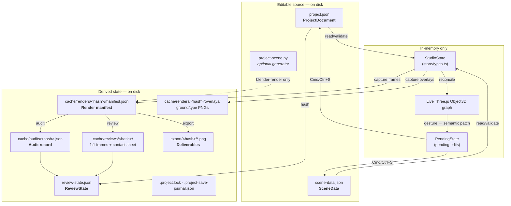
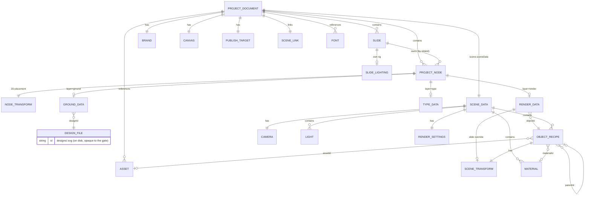

# XDS All Data models & Diagram

**The rules live in exactly one place:** `services/schema.py`. It describes `project.json`,
`scene-data.json` and `review-state.json` as data, and two consumers read that description:

1. the Python gate (`services/project/project.py`) that validates files on disk, and
2. the type generator (`uv run xds schema --emit-types`) that writes
   `packages/protocol/src/generated/project-types.ts`.

The editor holds no rules of its own: it consumes the generated types and the gate's verdict
from the API. There is no zod schema and nothing is mirrored field-by-field;
`uv run xds schema --check` (and `tests/test_schema_types.py`) prove the checked-in types
still match the rule set.

---

## 1. Where data lives



Legend: solid arrows are the normal path; the dashed arrow is the explicitly-optional
Blender generator path.

**Key idea:** two files are *source* (`project.json`, `scene-data.json`). Everything else is
either a byte-for-byte derived cache or a small bookkeeping record keyed by a **source hash**.
`project-scene.py` is optional source that ordinary operations only inspect; it is required
when running the headless Blender renderer (`--renderer blender`).

---

## 2. `project.json` — `ProjectDocument`

`schemaVersion` is the literal `"1.0"`. The object is validated with `.strict()`
(unknown fields are rejected).

| Field | Type | Notes |
| --- | --- | --- |
| `schemaVersion` | `"1.0"` | literal |
| `id` | `string` | non-empty project id |
| `name` | `string` | non-empty |
| `description` | `string` | may be empty |
| `createdAt` / `updatedAt` | ISO 8601 string | datetime |
| `canvas` | `Canvas` | the *design* space |
| `publishTarget` | `PublishTarget` | the *deliverable* |
| `brand` | `Brand` | color palette + per-role typography |
| `layout` | `LayoutTokens` | `outerInset`, `contentInset`, `gutter`, `baseline`, `minimumGap`, `safeArea` |
| `layerOrder` | `Layer[]` | optional; the composition stack (back → front), a permutation of the four layers |
| `slides` | `Slide[]` | min 1, unique ids and orders |
| `nodes` | `ProjectNode[]` | all layers, all slides |
| `assets` | `Asset[]` | project-contained binaries |
| `fonts` | `FontFile[]` | referenced font files |
| `scene` | `SceneLink` | points at `scene-data.json` |

### 2.1 `Canvas`

```ts
{ width: number; height: number; unit: "px"; background: string }
```

`background` is a non-empty string; by convention it is a **brand color token name** (e.g.
`"paper"`) rather than a hex value. The schema only requires the string, so the token lookup is a
convention the editor and audit follow, not a gate check.

### 2.2 `PublishTarget`

```ts
{ name: string; width: number; height: number; format: "png"; colorSpace: "srgb" }
```

`canvas` is the internal design space; `publishTarget` is what export must match exactly.
Export scales the design space to the target; a mismatch is a validation concern.

### 2.3 `Brand`

```ts
{
  name: string;
  colors: { hex: string; name: string }[];        // min 1, unique names
  typographyStyles: Record<string, {               // keyed by role; membership is authored
    fontFamily?: string;
    fontSize?: number;                             // optional: derived from the export band when absent
    bold?: boolean;
    italic?: boolean;
    colorToken?: string;
  }>;
}
```

The map is **authored, not seeded**: a role exists exactly when the brand declares it, and every
type node's `role` must name a declared key. An entry may carry only the properties the brand
overrides; its size derives from the export target band (`services/targets.py`) when `fontSize`
is absent. The brand inspector is where roles are created.
Legacy `fontFallbacks`, `fontFamily`, `spacing`, `voice`, and `typeScale` are retired.

### 2.4 `Slide`

```ts
{
  id: string; order: number;         // int, unique, >= 0
  name: string; 
  interface: string[];
  lighting?: SlideLighting;          // the slide's own rig (see 2.4.1)
}
```

#### 2.4.1 `SlideLighting`

A slide's complete, self-contained lighting choice. `baseline` is the authored rig the pure
knobs scale and `lights` is the effective rig after they are applied; both are stored so a
save/reload keeps the knobs reversible. `presetId` is present only when a fixed rig is active.

```ts
{
  presetId?: string;                 // → apps/studio/src/scene/lighting.ts LIGHTING_PRESETS
  intensity: number;                 // rig intensity multiplier
  direction: number;                 // yaw orbit around the Y axis (degrees)
  pitch: number;                     // tilt above/below the horizon (degrees)
  softness: number;                  // emitter-size multiplier
  environmentIntensity: number;      // ambient/hemisphere strength
  exposure: number;                  // tone-mapping exposure
  baseline?: LightRecipe[];          // the rig the knobs scale
  lights: LightRecipe[];             // the effective rig (baseline + knobs)
}
```

### 2.5 `ProjectNode` — the editable unit

Every node belongs to one slide and one layer. `layer` drives which `data` shape is legal, and
within `nodes` each slide's entries must appear in ascending `layerOrder` order (the field listed
under `ProjectDocument`), or the audit reports `ILLEGAL_LAYER_ORDER`.

```ts
{
  id: string;                // unique across the project
  slideId: string;           // must exist
  layer: "ground" | "image" | "render" | "type";
  kind: string;              // must equal data.kind
  name: string;
  transform: NodeTransform;  // 2D placement
  data: GroundNodeData | RenderNodeData | ImageNodeData | TypeNodeData;
}
```

`NodeTransform` (2D, canvas-percentage coordinates):

```ts
{
  x: number; y: number;                 // finite, percent origin (top-left, y down)
  width: number; height: number;        // positive
  rotation: number;                     // degrees
  opacity: number;                      // 0..1
  visible: boolean;
}
```

**Ground node data** (`layer: "ground"`) — a binding to an authored SVG design:

```ts
{
  kind: "design";
  designId: string;                    // → designs/<designId>.svg
  variant?: string;                    // the applied variant name, if any
  values?: Record<string, string | number | boolean>;  // parameter overrides
}
```

**Design** (`designs/<designId>.svg`) — one self-contained SVG file holding both the artwork and
its knob manifest, in a `<metadata id="xds-design">` element:

```ts
interface DesignSpec {                 // parsed tolerantly by services/designs.py
  name?: string;
  params: {                            // one control per entry; the inspector builds it from `type`
    name: string;
    type: "number" | "color" | "select" | "boolean" | "text";
    label?: string;
    default?: string | number | boolean;
    min?: number; max?: number; step?: number;
    options?: string[];                // for "select"
  }[];
  variants?: { name: string; values: Record<string, string | number | boolean> }[];
  svg: string;                         // the raw artwork, with {{name}} placeholders
}
```

A placeholder in the artwork may be a bare param name — resolved for its type (a `color` to its
brand hex, a `boolean` to `1`/`0, text verbatim) — **or an arithmetic expression** over the params
and any enclosing loop variable, and any element may carry `data-xds-repeat`/`data-xds-count` to be
cloned per iteration. That is what lets a knob reshape the structure (`density`, `count`,
`frequency`) rather than only recolor it; `apps/studio/src/design/resolve.ts` evaluates it in the
browser, identically to the headless capture. The
file is **opaque to the gate**: `services/designs.py` reads the manifest for the editor, but
neither the artwork nor its knobs are validated. A ground node is valid as long as its file
exists; naming a missing one is `UNKNOWN_DESIGN`. `designs/` is part of the project layout and
its files are folded into the source hash. The browser is the only renderer for this layer.

**Render node data** (`layer: "render"`) — a slide-scoped instance of a scene object:

```ts
{
  kind: "scene-object";
  objectId: string;                     // → SceneData.objects[].id
  role: "background" | "environment" | "support" | "subject" | "accent";
  anchorId?: string;
  transform?: SceneTransform;           // per-slide object placement override
  hidden?: boolean;                     // per-slide visibility
  cameraTransform?: SceneTransform;     // per-slide camera view override
  cameraTarget?: [number, number, number]; // per-slide camera look-at target
}
```

A render node is where a slide overrides **one scene object** — its placement, visibility and
the camera view. The object itself (`parameters`, `materialId`, topology) is shared through
`SceneData.objects`; the render node's `transform`/`hidden` are per slide, so moving or hiding an
object on one slide leaves it in place on every other slide. Editing an object only ever writes
this node, never the shared catalogue entry.

Lighting is **not** stored here: it belongs to the slide, in its own `lighting` block (see
2.4.1). `SceneData.lights` and `SceneData.renderSettings` are authored defaults, frozen at
author time; a slide with no `lighting` block is rendered with them.

**Image node data** (`layer: "image"`) — a 2D image bound to a project asset:

```ts
{
  kind: "image";
  assetId: string;                      // → ProjectDocument.assets[].id, kind "image" | "svg"
  fit?: "cover" | "contain" | "fill";   // CSS object-fit; defaults to "cover"
}
```

The browser renders the asset (`ImageVisual`) and the node's `transform` places the box in
canvas percent. An `assetId` that names no asset, or one whose kind is not image/svg, fails with
`UNKNOWN_ASSET`.

**Type node data** (`layer: "type"`):

```ts
{
  kind: "text" | "decoration";
  text: string;
  role: string;                         // must name a declared key in brand.typographyStyles
  horizontalAlign: "left" | "center" | "right";
  verticalAlign: "top" | "middle" | "bottom";
  colorToken?: string;
  spacingToken?: string;
  targetObjectId?: string;              // optional 3D anchor target
  targetAnchorId?: string;
  offsetX: number; offsetY: number;
  bold?: boolean; italic?: boolean;
  fontSize?: number;                    // per-instance override
  fontFamily?: string;
}
```

**Effective font-size resolution** (identical in editor and audit):
`data.fontSize` → `brand.typographyStyles[role].fontSize` → the export target's derived band
default (`services/targets.py`). The band always exists (an unknown role falls back to `body`),
so a type node's size is never missing and the audit never reports one absent.

### 2.6 `Asset` and `FontFile`

```ts
Asset    = { id; path; kind: "image"|"svg"|"model"|"video"; role };   // path project-relative
FontFile = { id; path; family; weight: 100..900 };
```

### 2.7 `SceneLink`

```ts
{ sceneData: "scene-data.json"; activeSlideId: string }
```

---

## 3. `scene-data.json` — `SceneData`

Stores the **shared 3D object catalog** that slide render nodes instantiate. R3F consumes
it directly.

| Field | Type | Notes |
| --- | --- | --- |
| `schemaVersion` | `"1.0"` | literal |
| `sceneId`, `name` | `string` | |
| `units` | `"metric"` | literal |
| `rotationUnit?` | `"degrees"` | default degrees |
| `rotationOrder?` | `"XYZ"`…`"ZYX"` | default `XYZ` |
| `objects` | `ObjectRecipe[]` | acyclic `parentId`, unique ids |
| `materials` | `Material[]` | unique ids |
| `camera` | `Camera` | exactly one main camera |
| `lights` | `Light[]` | min 1, unique ids; the authored default, not any slide's rig |
| `renderSettings` | `RenderSettings` \| legacy | THREE renderer settings; authored ambient/exposure default |

### 3.1 `SceneTransform` — the 3D transform

```ts
{
  location: [number, number, number];
  rotation: [number, number, number];   // Euler degrees, XYZ order
  scale: [number, number, number];      // each non-zero
}
```

NaN/infinity and zero scale are rejected. This is the shared vocabulary between
`scene-data.json`, slide overrides, `editor-core` conversion functions, and the Blender
worker.

### 3.2 `ObjectRecipe`

```ts
{
  id: string; name: string;
  kind: "box" | "sphere" | "cylinder" | "torus" | "plane" | "image";
  parameters: Record<string, string | number | boolean>;
  transform: SceneTransform;
  materialId?: string;
  parentId: string | null;              // acyclic
  assetId?: string;
  hidden: boolean;
  renderable: boolean;
}
```

### 3.3 `Material`, `Camera`, `Light`

```ts
Material = { id; name; color: { r; g; b; a } /* 0..1 */; metallic: 0..1; roughness: 0..1 };

Camera = {
  id; name; type: "perspective" | "orthographic";
  transform: SceneTransform;
  lens; sensorWidth; clipStart; clipEnd;              // clipEnd > clipStart
  target: { objectId?; location: [x, y, z] };
};                                                    // name must be "Main camera"

Light = {
  id; name; type: "area" | "point" | "sun";
  transform: SceneTransform;
  color: "#rrggbb"; intensity: >= 0;
  size: > 0;                            // emitter size; a softness knob scales this
  target: { objectId?; location: [x, y, z] };
};
```

The five lighting rigs the editor applies are fixed presets in
`apps/studio/src/scene/lighting.ts`: each fully replaces the light set and carries its own
`environmentIntensity`, so a rig is one deterministic, reversible choice. Choosing one writes it
to the **slide's** `lighting` block (2.4.1), never to `SceneData.lights`.

### 3.4 `RenderSettings`

```ts
{
  renderer: "THREE";
  antialias: boolean;
  toneMapping: "NoToneMapping" | "LinearToneMapping" | "ReinhardToneMapping"
             | "CineonToneMapping" | "ACESFilmicToneMapping" | "AgXToneMapping"
             | "NeutralToneMapping";
  toneMappingExposure: number;                          // > 0
  shadows: "none" | "basic" | "soft" | "variance";
  environment: { type: "color"|"cubeTexture"|"equirectangular"|"scene";
                 value: string | null; intensity: >= 0 };
  outputColorSpace: "srgb" | "linear-srgb";
  resolution: { width: number; height: number };
}
```

A legacy Blender-shaped settings object (`engine`, `samples`, `world`, `colorManagement`, …)
is still accepted by the union for backward compatibility, but new projects always write the
`renderer: "THREE"` form.

---

## 4. `review-state.json` — `ReviewState`

Bookkeeping that binds review decisions and the audit result to a specific source hash.

```ts
{
  schemaVersion: "1.0";
  projectId: string;                    // must match project.json.id
  sourceHash: string;                   // 64-hex combined source digest
  reviews: { slideId; status: "pending" | "approved" | "rejected";
             reviewedAt?: ISO8601; notes: string }[];
  lastAudit: { status: "pass" | "block"; at: ISO8601;
               detailsPath: string; sourceHash: string } | null;
  reviewBundle?: { createdAt; sourceHash; manifestPath;
                   contactSheetPath; slides: { slideId; path }[] };
  exportReady: boolean;
}
```

Because `sourceHash` is embedded, any edit to project.json or scene-data.json invalidates
the review state: it can no longer certify a different source for export.

---

## 5. Derived artifacts

### 5.1 Render manifest — `cache/renders/<source-hash>/manifest.json`

```ts
{
  schemaVersion: "1.0";
  status: "complete";
  mode: "final";
  renderer: "three" | "blender";
  sourceHash: string;
  sourceHashes: Record<string, string>;         // per-file digests
  createdAt: ISO8601;
  projectId: string;
  cacheDirectory: string;
  slides: {
    slideId: string; slideNumber: number;
    renderPath: string;                          // transparent PNG (3D only)
    metadataPath: string;
    width: number; height: number;
    overlayPaths?: Record<string, string>;       // browser layers, keyed by layer id
  }[];
}
```

Renderer-neutral: review and export read `renderPath`/`metadataPath` the same way whether
the frames came from the R3F canvas or Blender. The browser layers' PNGs live in a hash-keyed
overlay cache (`.../overlays/<slide>.<layer>.png`) so they survive a Blender re-render that
rewrites the manifest.

### 5.2 Audit record — `cache/audits/<source-hash>.json`

An immutable snapshot of one audit run (`summary` + full `diagnostics`).

### 5.3 Review bundle — `cache/reviews/<source-hash>/`

`full-size/<slide>.png` 1:1 frames plus `contact-sheet.png`.

### 5.4 Export — `export/<source-hash>/<slide>.png`

Exact `publishTarget` dimensions, composited Ground → 3D → Type.

---

## 6. In-memory models (not persisted)

### 6.1 `StudioState` (`apps/studio/src/store/types.ts`)

The whole editor state (the interface lives in `store/types.ts`; `store/index.ts` wires the
slices): `project`, `scene`, `review`, `api`, `phase`, `mode`, `transformMode`,
`transformSpace`, `activeSlideId`, `selectedNodeId`, `selectedObjectId`, `pending`,
`baseProject`/`baseScene`/`baseHashes`, `lockedNodeIds`, `lockedObjectIds`, `conflictPaths`,
`validation`, `notices`, `renderer`, `rendering`, `targets`, `zoom`, `snap`,
`commandPaletteOpen`, `designs`, `layerSolo`, `inspectorTab`, `exports`, `captureProgress`,
`targetBands`, `openProjectDialogOpen`, `openProjectDialogTab`, `slideCameras`, `slideLighting`,
and the lighting knobs (`lightingPresetId`, `lightingIntensity`, `lightingDirection`,
`lightingPitch`, `lightingSoftness`, `lightingEnvironmentIntensity`, `lightingExposure`,
`lightingBaseline`).

`baseProject`/`baseScene`/`baseHashes` are the **last-saved** snapshot, used as the base for
three-way rebase when files change on disk.

### 6.2 `PendingState` (`packages/editor-core/src/pending.ts`)

```ts
PendingChange = {
  id: string;                                 // `${domain}:${path}:${at}`
  domain: "project" | "scene";
  path: string;                               // e.g. "nodes.<id>.transform"
  summary: string;                            // human-readable
  at: ISO8601;
};
PendingState = { project: PendingChange[]; scene: PendingChange[] };
```

Also defined here: `RebaseConflict`, `RebaseResult`, and the leaf-level three-way
`rebaseValue`/`rebaseProject`/`rebaseScene` used when external edits arrive.

### 6.3 Live Three.js graph

Real `Object3D`s reconciled from `SceneData`. The mapping contract is:

```text
SceneData object ID  ↔  Three Object3D runtime key  ↔  the active slide's render node
```

Transforms are stored in local parent space; rotation is Euler degrees `XYZ`; position is
`location`; scale is non-zero. Only fields owned by a completed gesture are patched, and
selection/hover/helper geometry is never serialized.

---

## 7. Type relationships at a glance



---

## 8. Validation layers

There is one rule set (`services/schema.py`) and one gate:

1. **Python** (`services/project/project.py`) — the only validator. It runs on disk for every
   load, save, audit, review, and export, and additionally checks the directory layout
   (`assets/`, `fonts/`, `designs/`, `cache/`, `export/`), file existence for referenced
   assets/fonts and ground designs, path containment (no `..`, no absolute paths), and the AST
   safety policy for `project-scene.py`.
   `tests/test_schema_parity.py` pins its exact verdicts (code, message and path).
2. **TypeScript** (`packages/protocol`) — declarations generated from that rule set. The editor
   shows the gate's verdict instead of re-deriving one; its `api.ts` consumes the API payload
   directly.

The structural stage of the audit reuses the Python gate; the rendered stage
(`services/audit.py`) adds geometry, overflow, legibility, overlap, and layer-order diagnostics
such as `NODE_OVERFLOW`, `TEXT_BOX_OVERFLOW`, `TEXT_OVERLAP`, `TEXT_TOO_SMALL`,
`TEXT_LOW_LEGIBILITY`, `TEXT_TOO_LARGE`, and `ILLEGAL_LAYER_ORDER`. Text geometry is
**measured in the browser** (see `services/measure.py`): a slide that was never measured
reports `GEOMETRY_UNMEASURED` rather than being estimated.
