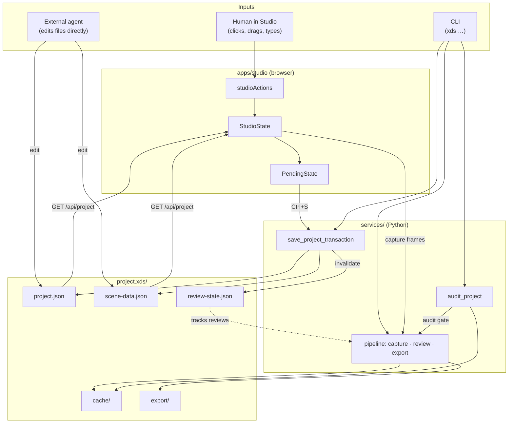
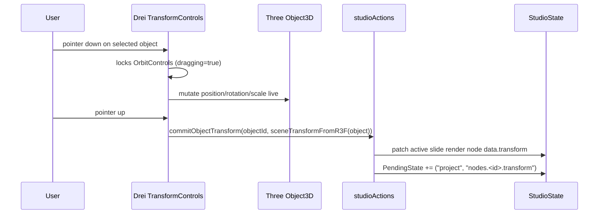
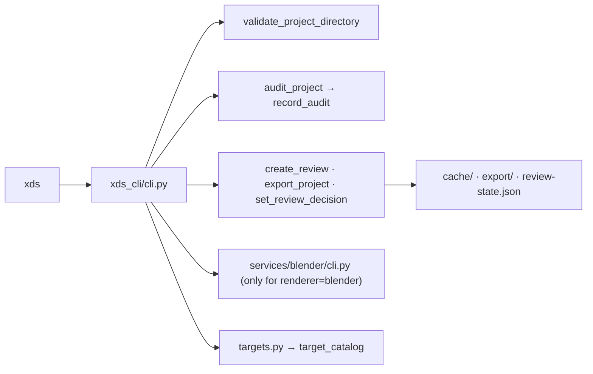
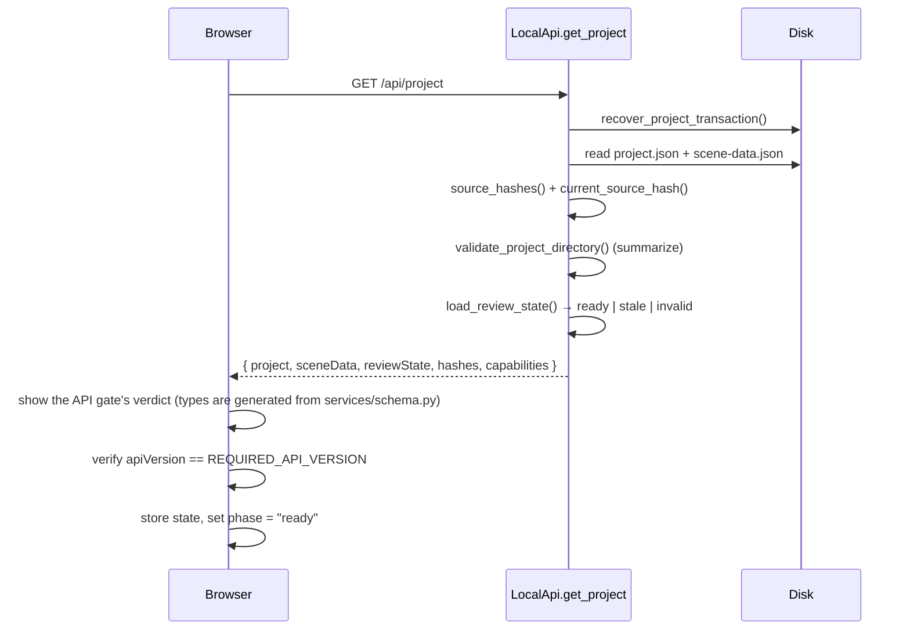
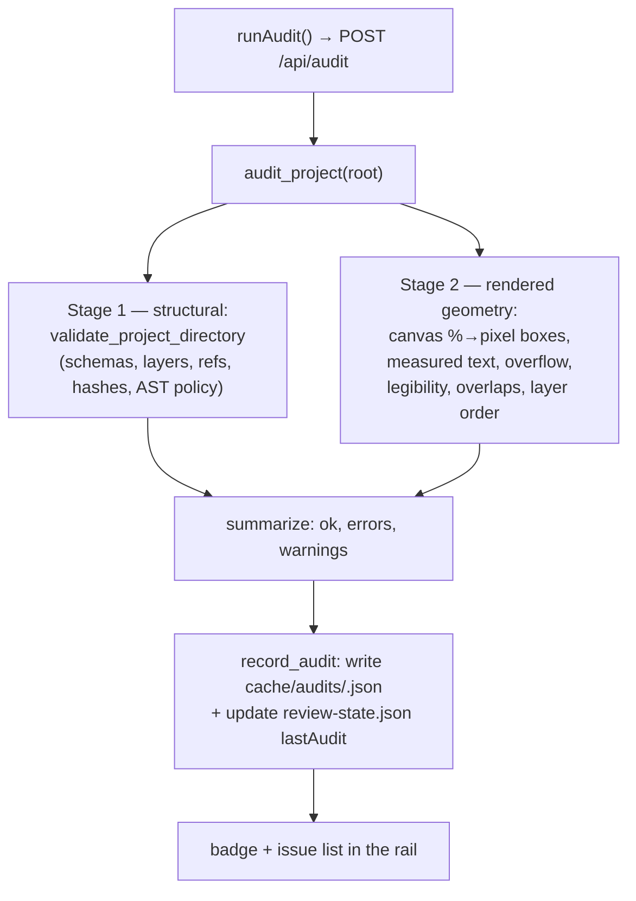
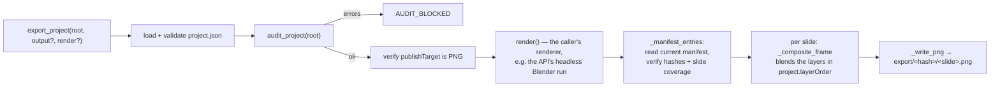
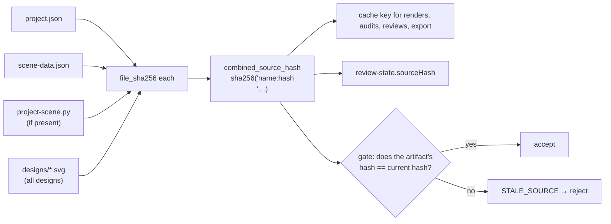

# Dataflow

This page follows the data: where each input comes from, what transforms it, and where it
goes. There are three input sources — the **human in the editor**, an **external agent
editing files**, and the **CLI** — and they all converge on the same two editable files.

---

## 0. The whole picture



The two persistent sources are `project.json` and `scene-data.json`. Every other artifact is
derived, hash-keyed, and disposable. Nothing writes to source except the guarded save
transaction (and, deliberately, an external agent editing the files).

---

## 1. Input: the human in the editor

### 1.1 Edit → pending (never straight to disk)

No pointer movement writes a file. An interaction calls a method on `studioActions`
(`store/index.ts`), which:

1. **Guards** it — the node's layer must match the current mode (`guardNode`), the node
   must not be locked, and Present mode rejects everything.
2. **Mutates** `StudioState` in memory (e.g. `transformNode`, `updateNodeData`,
   `updateObjectTransform`).
3. **Records** a `PendingChange` via `track()` — domain (`project`/`scene`), path
   (e.g. `nodes.<id>.transform`), summary, timestamp. Pending entries are de-duplicated by
   `domain:path`.

```text
click / drag / keystroke
  → studioActions.<mutation>()
  → guard (mode + lock)
  → StudioState update
  → PendingState += { domain, path, summary, at }
```

### 1.2 3D gesture → semantic transform

A 3D manipulation is a two-phase flow because the real `Object3D` moves during the drag:



Only the **active slide's render node** in `project` is written; the shared catalog object in
`scene` stays the authored reference every other slide falls back to. Writing just the render
node is what keeps per-slide pose independent. Keyboard nudging uses the same
`commitObjectTransform` path.

Similarly, **camera navigation** (orbit, pan via right-mouse drag, zoom) and **studio lighting**
are isolated per slide:

- `updateCameraView(transform, target)` records the slide's camera view on the active slide's
  render nodes and `slideCameras[activeSlideId]`.
- Every lighting action (`applyLightingPreset`, `setLightingIntensity`, `setLightingDirection`,
  `setLightingPitch`, `setLightingSoftness`, `setLightingEnvironmentIntensity`,
  `setLightingExposure`, `updateLightTransform`, `updateLightProperty`) funnels through one
  writer that updates `slideLighting[activeSlideId]` and persists the rig, ambient and exposure
  into the active slide's own `lighting` block.
- No lighting action mutates `SceneData.lights` or `SceneData.renderSettings`: those are the
  file's authored defaults, frozen at author time. A save therefore writes each slide's own rig
  and leaves the global scene untouched. A slide with no `lighting` block renders with the file's
  default lights.
- Switching slides re-reads that slide's record and follows it in the 3D viewport, the lighting
  controls and the camera. A slide that was never given a rig falls back to the file default —
  never to the previously active slide's rig.

### 1.3 Save → guarded transaction → disk

`Ctrl/Cmd + S` calls `saveAll()`, which POSTs `{ project, sceneData, baseHashes }` to
`/api/save`. On the server, `save_project_transaction` runs:

```text
validate project + scene (full schema)
  → acquire advisory lock (.project.lock)
  → re-check baseHashes == current file hashes      (abort → SAVE_CONFLICT)
  → read original bytes (rollback backups)
  → compute new combined source hash
  → write journal (.project-save-journal.json)
  → atomically replace project.json
  → atomically replace scene-data.json
  → if hash changed: invalidate review-state.json
  → mark journal committed, clean backups
```

Any failure after the first replacement rolls back to the exact original bytes. If the
process dies mid-save, `recover_project_transaction` finishes a committed journal or rolls
back an incomplete one on the next load. The response returns the new `hashes`,
`baseHashes`, `sourceHash`, and the fresh `reviewState`; the frontend resets `base*` state
and clears pending.

**Pending changes are all-or-nothing.** A stale base hash, a failed transform round-trip, or
a validation error aborts without writing.

---

## 2. Input: an external agent editing files

An agent edits `project.json`, `scene-data.json`, assets, or `project-scene.py` directly.
It then uses the same CLI a human would (`xds audit`, `xds preview`). The editor
notices changed files when it next reads them:

```text
disk file changed
  → reloadFile()
  → GET /api/project (fresh project + hashes)
  → three-way rebase:
       base    = baseProject/baseScene  (last saved)
       local   = current pending state
       remote  = newly loaded files
     * leaf-level; remote wins concurrent edits
     * non-conflicting local edits rebase in
     * overlapping edits become RebaseConflicts
  → conflicts shown in the rail; user resolves local/remote before saving
```

Rules that keep this safe:

- A changed **source hash** stales every render, audit, review, and acknowledgement.
- Conflicting edits **never auto-overwrite**; the user decides.
- External edits cancel any in-flight gesture.

---

## 3. Input: the CLI / agent commands

The CLI reads **current saved source only** — never a private copy. Each command flows into
the shared services:



`--json` makes every command machine-readable for deterministic agent parsing.

---

## 4. Load path: disk → editor



If the API gate or the version handshake fails, the editor renders `ErrorState` — it does not
fall back to a demo project. (There is a demo fixture used only in tests.)

---

## 5. Render path: source → frames → manifest

### 5.1 Three.js (default, browser — open editor or headless worker)

```mermaid
sequenceDiagram
  participant U as User
  participant S as store.renderFinal()
  participant F as Fontshare loader
  participant B as CaptureBridge / overlay
  participant API as /api/render/capture + /overlays
  participant D as cache/renders/<hash>/

  U->>S: click Render (saved source)
  S->>S: refuse if pending edits exist
  S->>F: ensureFontshareStyles + ensureFontshareFamiliesLoaded
  S->>S: switch to Present mode
  loop each slide (ordered)
    S->>S: set active slide; wait a frame
    S->>B: wait for the slide's 3D objects, then capturePng(w,h) (WebGLRenderTarget → base64 PNG)
    S->>B: for each DOM layer in layerOrder: captureOverlayPng(layer, w, h)
    note over S,B: ground adds canvasBackground; type adds the scoped fontEmbedCSS
    S->>S: push frame and its phase timings
  end
  S->>API: POST /api/render/capture { baseHashes, slides[] }
  S->>API: POST /api/render/overlays { baseHashes, slides[] }
  API->>API: verify baseHashes == current, size == publishTarget
  API->>D: write frames + manifest.json (renderer: "three")
  API->>D: write overlays/<slide>.<layer>.png
  S->>S: restore mode + slide
```

The capture also carries the laid-out type measurements (`measures`), so the audit never has
to estimate text geometry. Each DOM layer travels as one `frames` entry (`{ layer, png }`). The
ground capture carries the canvas background, because it is the slide's backdrop: `pipeline.py`
never fills a background of its own.

Key checks in `_capture_source`: the payload's `baseHashes` must match the **current** file
hashes (otherwise `CAPTURE_STALE_SOURCE`), and every frame must be exactly the publish-target
size (otherwise `RENDER_SIZE_MISMATCH`). The size check reads the PNG header only — the
pixels are decoded once, in `_composite_frame`, where they are actually needed.

Each slide is three browser rasterizations, and each one is timed. The running Exports row
and `window.__xdsCapture.phases` report lines like `3D 15.1s · ground 0.6s · type 0.8s`.
Two costs were found and removed by measuring: the font payload above, and a capture that
fired before the slide's GLBs had loaded (it now waits for the slide's objects and fails by
name if one never arrives, rather than writing an empty 3D frame).

### 5.2 Blender (optional, headless)

```text
xds render --renderer blender   (the rail's Blender export runs this same render,
                                      after the export's gates)
  → services/blender/cli.py: find_blender()
  → for each slide:
      run: blender -b -P workers/blender/render.py -- --project … --mode final --slide N
      worker: validate_render_project → execute_project_source → build_scene
              → configure render → bpy.ops.render.render()
              → write PNG + metadata JSON
      orchestrator: re-check source hashes (STALE_SOURCE on change)
                    copy artifacts → cache/renders/<hash>/
  → write manifest.json (renderer: "blender")
  → run the browser capture in "overlays" mode for the same source
```

Because Blender re-renders and rewrites its own manifest, browser Ground/Type overlays are
stored in the **separate** hash-keyed overlay cache (via `/api/render/overlays`) so they can
still be composited at export. A final Blender render and its overlay capture are one unit:
if the overlays cannot be captured, the command reports `BROWSER_UNAVAILABLE` (or the
worker's own code) instead of leaving a manifest that can never be reviewed or exported.

### 5.3 Headless capture worker

```text
xds render PROJECT --renderer three
  → services/browser.py: find Chrome, resolve a free API port, ensure the local API
  → npm run capture --workspace @xds/studio  (apps/studio/capture/main.mjs)
      serves the Studio (Vite) and points its /api proxy at that port
      opens http://127.0.0.1:<web>/?capture=three in headless Chrome
      waits for window.__xdsCapture (status, message, per-phase timings)
  → the editor runs store.renderFinal() / store.captureOverlays()
      and posts to the same /api/render/* routes the buttons use
```

The worker renders nothing itself — it only drives the browser — so the headless and
interactive paths are the same code and cannot drift. It starts its own Vite server and
never binds the Studio's API port: the CLI reuses `8765` only when that API serves the same
project, and otherwise takes a free capture port. The API never renders either: a direct
`POST /api/render {"renderer":"three"}` still answers `THREE_CAPTURE_REQUIRED`, because the
API has no browser of its own.

`review` and `export` require a manifest whose ground **and** type overlays exist, from the
manifest or the overlay cache. Missing overlays raise `OVERLAY_REQUIRED`; nothing is
substituted for them.

---

## 6. Audit path: source → diagnostics → certificate



The rendered stage maps each node's canvas-percentage transform to an exact pixel rectangle
(`node_box`) and reads the laid-out text geometry the editor measured in the browser
(`services/measure.py`: node box, rendered line boxes, line count, effective font size). It
emits `NODE_OVERFLOW`, `TEXT_BOX_OVERFLOW`, `TEXT_OVERLAP`, `TEXT_TOO_SMALL`,
`TEXT_LOW_LEGIBILITY`, `TEXT_TOO_LARGE`, `UNKNOWN_DATA_TOKEN`, and
`ILLEGAL_LAYER_ORDER`. Rendered text checks need measurements: a slide without them reports
`GEOMETRY_UNMEASURED` (a warning) and the composition checks are skipped rather than estimated.
The result is bound to the current `sourceHash`; a stale result cannot certify a newer source.

---

## 7. Review path

```text
xds review PROJECT   (or the review/decision API)
  → load the current final render manifest (must be mode:"final", matching hashes)
  → for each slide: composite Ground → 3D → Type at target size
  → write cache/reviews/<hash>/full-size/<slide>.png
  → build contact-sheet.png
  → record reviewBundle in review-state.json (bound to sourceHash)
  → set decision per slide (pending | approved | rejected)
```

Recording a review invalidation is source-hash-bound: editing and saving invalidates the
bundle.

---

## 8. Export path: source → PNG



The gates that need no render artifact — the project, the audit, the publish target — run
before `render()`, so an export the audit blocks fails without paying for a renderer. A
renderer that captures in the browser (Three.js) hands in its own manifest and passes no
`render` at all.

Composite order follows **`project.layerOrder`**: `_composite_frame` blends the captured 3D frame
at the `render` slot and each DOM layer at its own slot. Every layer is a frame the browser
rendered — `pipeline.py` alpha-blends the provided PNGs and draws nothing itself. A manifest or
capture without a frame for every browser layer is rejected with `OVERLAY_REQUIRED` — nothing is
substituted. Export requires a **current** render
manifest and a passing audit; it blocks on errors, not warnings. The result lists every written
PNG (`files`) and an artifact URL, and the Studio's Present panel keeps finished exports with a
download link per slide.

---

## 9. Hash / freshness flow

Hashing is the spine that ties every derived artifact to the exact source it came from.



Formatting-only changes also change the raw hash and trigger a safe revalidation. This is why
the pipeline never serves a stale render, never accepts a stale review, and never exports
against changed source.

---

## 10. Field-level flow: a type node's font size

A good end-to-end example of how one input threads through the system:

```text
Export target selected (rail)
  → setExportTarget → scale_for_target(width, height)
  → stores the deliverable dimensions + the derived bands; rewrites no size  [project.json, pending]
  → save → project.json

Type node rendered (canvas)
  → resolveTypeFontSize(brand, data, bands)
      = data.fontSize ?? typographyStyles[role].fontSize ?? bands[role].default
  → DOM type layer

Audit (services/audit.py)
  → the audit reads the declared size with the same precedence
  → type_bands(publishTarget) gives min/default/max per role
  → TEXT_TOO_SMALL / TEXT_LOW_LEGIBILITY / TEXT_TOO_LARGE

Capture + composite
  → overlay.ts rasterizes the DOM type layer with the embedded Fontshare font
  → Python composites it unchanged at export
```

The same precedence rule (`data.fontSize` → `typographyStyles[role].fontSize` → the derived band
default) is implemented identically in `apps/studio/src/utils.ts` and `services/audit.py`, so the
editor and the audit never disagree about how large a piece of text is. The band always exists
(unknown roles fall back to `body`), so a size is never missing. Role *membership* is authored in
`brand.typographyStyles`, and a type node may only name a declared role.
