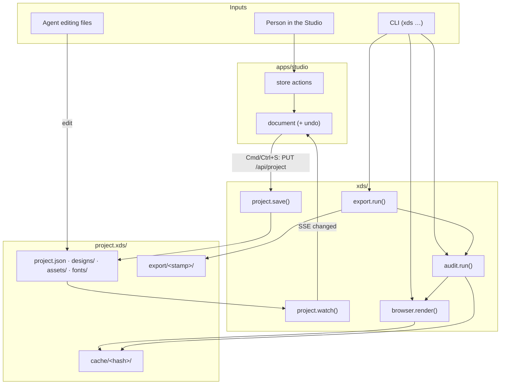
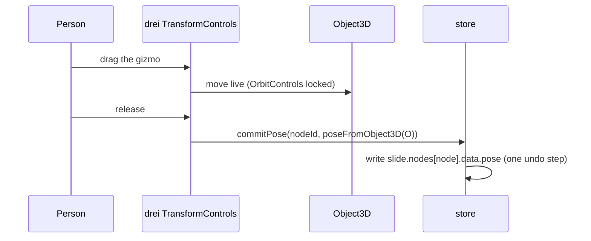
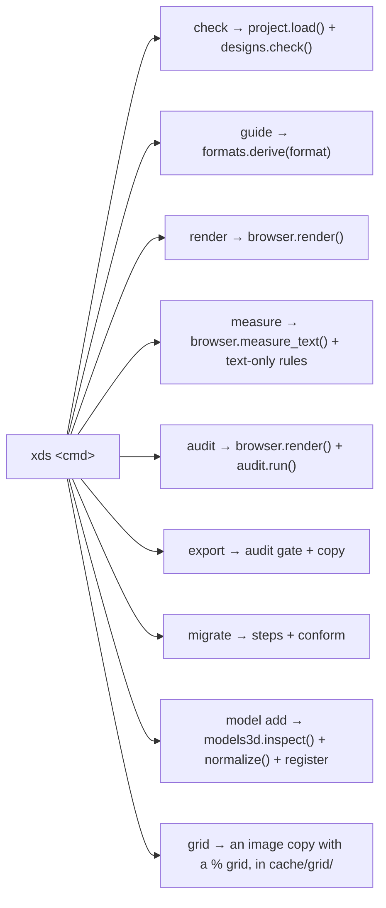
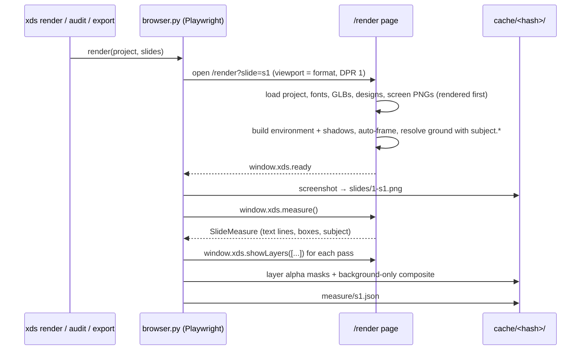
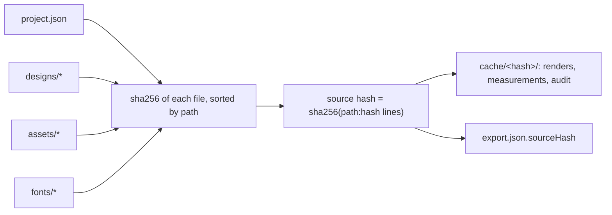

# Dataflow

This page follows the data: where each input comes from, what transforms it, and where it goes.
There are three inputs: a **person in the editor**, an **agent editing files**, and the **CLI**.
All three end up at the same source files.

---

## 0. The whole picture



Only `project.save()` (and, on purpose, an agent) writes source. Everything else writes into
`cache/<hash>/` or `export/`.

---

## 1. Input: a person in the editor

### 1.1 Edit → document → save

No pointer move writes a file. An interaction calls a store action, which:

1. **guards** it: the node's layer must match the mode, the node must not be locked, and
   Present mode rejects all edits;
2. **updates** the in-memory document (one undo step per completed gesture or field commit);
3. marks the document **dirty** if it now differs from the last saved copy.

`Cmd/Ctrl + S` sends `PUT /api/project { project, baseHash }`. The server:

```text
validate with Pydantic                    (422 with paths on failure)
  → hash the file on disk; ≠ baseHash?    (409 SAVE_CONFLICT)
  → set updatedAt; serialize (stable key order, 2-space indent)
  → write project.json.tmp, fsync, os.replace
  → return { hash }
```

The editor stores the new hash as `baseHash`, and the document is clean again. One file means
one atomic replace: there is no journal, lock or rollback, because there is nothing half-written
to roll back.

### 1.2 3D gestures



Only the active slide's render node is written. The catalog object's `pose` stays the default for
every other slide.

**Camera** gestures write the active slide's `camera`. In `frame` mode, orbit changes `yaw` and
`pitch`, scroll changes `height`, and pan changes `x` and `y`. **Lighting** gestures (`L` + drag,
or the inspector) write the active slide's `lighting` fields. A slide without a `lighting` block
shows the project default; the first change creates the block with just the changed fields.

---

## 2. Input: an agent editing files

An agent edits `project.json`, designs, screens or assets directly, then uses the CLI
([agent guide](./agent-guide.md)). **The file on disk is the truth.** If the editor is open:

```text
file changes on disk
  → watchfiles (in project.watch) → new source hash
  → SSE "changed" → editor reloads the document immediately
       unsaved editor edits are replaced (a notice says so)
       selection is kept for ids that still exist
       baseHash = the new hash
```

There is no prompt, no merge and no comparison. If a save from the editor races with an outside
change (`409 SAVE_CONFLICT`), the editor reloads the file in the same way.

---

## 3. Input: the CLI



The CLI reads saved source only. `--json` makes every command machine-readable.

`xds measure` is the fast path for text: one browser page visits
`/render?slide=<id>&layers=type` for each slide, so only the type layer mounts (no WebGL, no
models, screens, designs or images), waits for `window.xds.ready` (fonts loaded, stacks placed)
and calls `window.xds.measure()`. `layout.py` turns each `SlideMeasure` into per-block lines,
heights and stacks and runs the audit rules that need only text geometry. Nothing is cached.

---

## 4. Load: disk → editor

```text
GET /api/project
  → project.load(): read project.json, Pydantic-validate, compute hash
  → designs.load_all(): parse each designs/*.svg manifest
  → respond { apiVersion, project, designs, hash, check: { ok, findings } }
editor
  → verify apiVersion
  → document = project; baseHash = hash; subscribe /api/events
```

A project that fails the gate still opens, read-only, with the findings listed. This lets a person
see what an agent broke. It never falls back to a demo project.

---

## 5. Render: source → PNG



If a slide's PNG for the current hash already exists and its slide key (below) still points at this
hash, it is reused, so `audit` followed by `export` renders once; after an xds update the key
changes with the studio build, so the slide is drawn again. A slide is also reused across hashes when its own key is unchanged (its JSON, its
position, the rest of `project.json` minus other slides and timestamps, every other source file,
and the studio build): `cache/slide-keys/<key>.json` points at the dir that has it, and its files are
hard-linked in. Editing one slide re-renders only that slide. After each render the cache is pruned to the
5 most recently used hash dirs (`KEEP_HASHES`), and slide-keys pointing at a deleted dir are dropped;
other dirs in `cache/` (`slide-keys/`, `grid/`) are kept. Headless Chromium draws WebGL on the GPU
(Metal on macOS), about 2.5 s per slide. `XDS_SOFTWARE_GL=1` switches to SwiftShader for machines
without a GPU (CI); it is ~10x slower and differs slightly at anti-aliased edges. There, a hidden 3D
layer on the render page stops drawing frames, because SwiftShader replays every frame drawn while
hidden. The ground resolves after the render layer reports subject bounds, so a spotlight
background lands behind the product in the same frame. Layout relations (`layout`: pins, aligns, stacks,
fit) are resolved after the fonts load: the type layer measures each block's ink and content
height, the stage resolves every 2D node's rect (`@xds/editor-core` `resolveLayout`) and the
layers draw at those rects before the stage reports ready, so a screenshot never shows a block
in an unresolved place.

---

## 6. Audit: render → findings

```text
xds audit / POST /api/audit
  → check (structural; stop here if it fails)
  → render (§5, reusing cache)
  → for each slide: MeasuredSlide = measure json + PNG/masks as numpy arrays
  → thresholds = formats.derive(format) ⊕ project.rules
  → every rule in audit/rules/* → findings
  → apply node and slide exceptions → status "waived"
  → write cache/<hash>/audit.json + annotated/*.png
```

See [design rules](./design-rules.md) for every rule.

---

## 7. Export: findings → deliverables

```text
xds export [--pdf] / POST /api/export { format: png | pdf }
  → audit (reuses cache when current)
  → open errors?  → EXPORT_BLOCKED with the findings   (unless --force)
  → copy cache/<hash>/slides/*.png → export/<stamp>/
    (pdf: join them into export/<stamp>/<projectId>.pdf instead, a page per slide)
  → write export.json { sourceHash, format, files, audit summary, forced }
```

The editor refuses to export with unsaved edits and asks the person to save first, because the
export must match the file on disk.

---

## 8. Freshness



A different hash means a different cache folder, so stale results are never read. No "stale"
bookkeeping is needed.

---

## 9. Example: one type node's size, end to end

```text
format chosen (editor or xds init --format)
  → formats.derive(): s, k, u, m, size bands per level

type node rendered
  → size = data.size ?? brand.typography[role].size ?? band(level).default
  → DOM text in TypeLayer

xds guide
  → prints the band per level, so an agent picks a size inside it from the start

xds audit
  → measure() reports the size the browser actually used and each line's ink rect
  → TEXT_TOO_SMALL / TEXT_TOO_LARGE / HIERARCHY_WEAK / SIZE_NEAR_MISS compare it to the band
  → LOW_CONTRAST samples the pixels under each line rect
```

The size resolution happens in exactly one place, the browser. Python reads the measured result
instead of reimplementing it.
