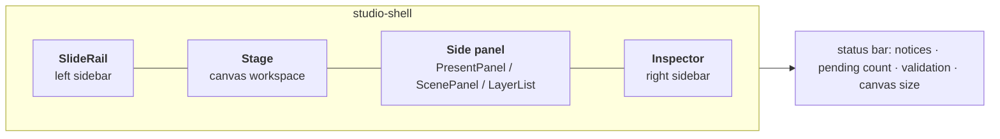

# Human interaction

This page describes the Studio editor screen — what is where, and where a person clicks,
drags, and types. It maps directly to `apps/studio/src/App.tsx` and the components under
`components/`.

Start the editor with:

```bash
uv run xds open                         # opens with the project opener
# or specify a project directly:
uv run xds open ~/xd-projects/my-project
```

This boots the local API (port `8765`) and the Vite UI (port `5173`), waits until both are
reachable, then opens a browser tab. Because the API does not auto-reload, restart with
`xds open` after backend changes; the editor refuses to run against an out-of-date
API and reports the version mismatch.

`xds open` owns those two processes: the session ends when *they* exit, not when
something else answers on the port — so a headless `xds render` running beside your
editor can neither take its API port nor shut it down.

---

## 1. Screen layout



The grid is `SlideRail | canvas-workspace | side panel | Inspector`, with a status bar
across the bottom containing the project name, the pending-edit count, the canvas size, and
the latest notice. Validation lives in the left rail (the **Audit** panel), not the status bar.

There is **no separate top navigation bar**. Everything lives in the left rail or the
canvas toolbar.

### 1.1 Left sidebar — `SlideRail`

Top to bottom:

| Zone | Contents | Actions |
| --- | --- | --- |
| Heading | "Slides", slide count | **`+` Add new slide** button (`addSlide`) |
| Slide list | index number, name, layer count, delete button per slide | click a row to activate (`setActiveSlide`); trash to delete (disabled when only one slide) |
| Audit | `ValidationPanel` — status badge, issue list | **Run audit** button |
| Pending edits | `PendingPanel` — last edits, or "Local state matches the last saved file" | — |
| Export target | `ExportTargetSelect` — grouped select (Social / Pixels / Paper / Custom) + W×H inputs when Custom | pick a preset, or type a custom size |
| Final render | renderer `<select>` (**Three.js** / **Blender**) | choose the renderer the export runs |
| Rail toolbar | Open project, Search, Reload, Export, Save icon buttons | see shortcuts below |

### 1.2 Center — the Stage

- **Canvas toolbar** across the top of the stage:
  - **Mode switcher**: `Present`, then the layers front → back — by default **Text**, **2D**,
    **3D**, **Background** (the active one is `aria-pressed`). Clicking switches mode, and the
    switcher follows the project's `layerOrder`.
  - In **3D** mode only: **Move / Rotate / Scale** buttons, and **World / Local** coordinate
    space buttons.
  - In every mode except Present: a **Snap** checkbox.
- **Zoom control** (float, top-left of the stage): `−` / percentage / `+`.
- **The canvas** — rendered inside a scrollable, zoomable viewport. Clicking empty canvas
  clears the selection.
- In Present and 3D modes the live `ThreeScene` R3F `<Canvas>` is mounted. Present is
  read-only; 3D is editable.

### 1.3 Side panel (right of the canvas)

The middle-right panel changes with mode:

| Mode | Panel | Contents |
| --- | --- | --- |
| Present | `PresentPanel` | the layer stack, front → back, with per-layer node counts and **up/down buttons that reorder it** (`moveLayer`); plus the **Exports** list — every finished export shows how many PNGs were written and where, with a numbered download link per slide |
| 3D | `ScenePanel` | the slide's 3D object list — click to select, eye to hide/show, lock, trash to remove from slide; footer has "+ Assign model from library…" and "+ New 3D shape…" |
| Text / 2D / Background | `LayerList` | the active layer's nodes — click to select, eye, lock, trash; footer has "+ New type…" / "+ New image…" / "+ New ground…" and duplicate / move-forward / move-backward / delete buttons |

### 1.4 Right sidebar — `Inspector`

The inspector's contents depend on mode:

| Mode | Inspector | What you edit |
| --- | --- | --- |
| Present | `BrandInspector` | the project-wide **brand system** |
| 3D | `SceneInspector` | the selected object: linked model, Translate / Rotate / Scale X-Y-Z fields |
| Text / 2D / Background | `DesignInspector` → `TransformInspector` + `GroundInspector` / `ImageInspector` / `TypeInspector` | the selected node |

### 1.5 `CommandPalette` (⌘K / Ctrl+K)

A modal over a dimmed backdrop. Type to filter; `Enter` runs the first match; `Escape`
closes. It lists: Open project folder…, New project…, Add new slide, Save all edits, Reload
project file, Run project audit, Switch to Text / 2D / 3D / Background, and a
"Go to slide N: <name>" entry per slide.

---

## 2. The modes

A mode is either `present` — the read-only composite — or one of the four layer ids. There is no
separate mode id: **Text**, **2D**, **3D** and **Background** are labels for the `type`, `image`,
`render` and `ground` layers. Switching modes is done from the canvas toolbar, the number keys,
or the command palette.

| Mode | Key | Layer exposed | Side panel | Inspector | Three.js? |
| --- | --- | --- | --- | --- | --- |
| **Present** | `1` | all layers (read-only composite) | PresentPanel | BrandInspector | yes, read-only |
| **Text** | `2` | `type` only | LayerList | TypeInspector | no |
| **2D** | `3` | `image` only | LayerList | ImageInspector | no |
| **3D** | `4` | `render` only | ScenePanel | SceneInspector | yes, editable |
| **Background** | `5` | `ground` only | LayerList | GroundInspector | no |

The composition order can be changed from **Present** mode: its side panel lists the layers
front → back and its up/down buttons call `moveLayer`, which rewrites `project.layerOrder` and
regroups `project.nodes` to match. The canvas stack, the mode switcher and the exported PNG all
follow that one order.

Mode ownership is enforced in state, not just by hiding UI: `store/index.ts` rejects a mutation
whose node's layer doesn't match the mode (`guardNode`), and switching modes clears
incompatible selection and gestures.

---

## 3. Keyboard shortcuts

Registered in `App.tsx` (and `Stage` for nudging). Shortcuts are ignored while typing in an
input, textarea, select, or contenteditable element.

| Shortcut | Action |
| --- | --- |
| `Ctrl/Cmd + S` | **Save all pending changes** (`saveAll`) |
| `Ctrl/Cmd + K` | Toggle the command palette |
| `1` / `2` / `3` / `4` / `5` | Present / Text / 2D / 3D / Background (fixed per mode; they do not move with the layer order) |
| `V` | Run project audit |
| `R` | Reload the project file from disk |
| `Delete` / `Backspace` | Delete the selected node (or 3D object in 3D mode; respects locks) |
| `Escape` | Close palette, clear selection |
| `←` / `→` | Nudge selected 3D object on X (3D mode) |
| `↑` / `↓` | Nudge selected 3D object on Y (3D mode) |
| `PageUp` / `PageDown` | Nudge selected 3D object on Z (3D mode) |

Nudge step: `0.05 m` by default, `0.25 m` when **Snap** is on, `0.5 m` with `Shift`.

In the 3D viewport: **left-drag** orbits the camera (when not transforming), **scroll**
zooms, and a selected object shows Drei `TransformControls` whose mode follows the
Move/Rotate/Scale buttons. Orbit is locked while a transform drag is in progress.

---

## 4. Task walkthroughs — where to click

### Create a project

From a terminal: `uv run xds init ~/xd-projects/my-project --name "My Project"`. This
scaffolds the directory with a single blank slide, an empty 3D scene, and a one-token brand —
content is authored on top, so the scaffold never seeds a design. A fully authored reference
project lives in `packages/protocol/example/`.

### Open a project

`uv run xds open ~/xd-projects/my-project`. The editor loads `GET /api/project`; if the
API is unreachable it shows an `ErrorState` with a **Retry** action — it never loads a fake
project.

### Add a slide

Click the **`+`** button in the SlideRail header, or run "Add new slide" from the palette.
A new slide (with a default Ground node and Type headline) becomes active immediately.

### Add a 2D node (Ground or Type)

1. Switch to **Background**, **2D** or **Text** (keyboard `5` / `3` / `2`).
2. In the side panel footer, open **"+ New ground…"** (pick one of the project's SVG designs in
   `designs/`) or **"+ New type…"** (the roles the brand has declared in **Brand Typography**;
   declare a role there first if the list is empty). The node is created and selected.

### Edit a selected node

- Drag it on the canvas, or type exact values in the inspector (`TransformInspector` for
  x/y/width/height/rotation/opacity/visible).
- **Type nodes** (`TypeInspector`): edit Text Content, Preset role, Font Family, Font Size,
  Bold/Italic, the **9-position alignment matrix**, and the brand color swatch.
- **Ground nodes** (`GroundInspector`): the **Form** dropdown (the design's declared variants) and
  one control per design parameter — a scrubbable number field for a number, a brand-token swatch
  for a color, a dropdown for a select, a checkbox for a boolean, a textarea for text. The controls
  are generated from the design file's own manifest, so a new design needs no UI change.

### Add and manipulate a 3D object

1. Switch to **3D** (key `4`).
2. In `ScenePanel`, use **"+ New 3D shape…"** (box, sphere, cylinder, torus, plane) to add a
   shape — this creates both a scene object and a slide render node. Or **"+ Assign model
   from library…"** to instance an existing object on this slide.
3. Click an object in the list or directly in the viewport (raycast selection) to select it.
4. Choose **Move / Rotate / Scale**, then drag the gizmo in the viewport — or type exact
   values in `SceneInspector` (Translate/Rotate/Scale, X/Y/Z), or nudge with the arrow keys.
5. Toggle **World / Local** space for nested or rotated objects. Use the eye icon to hide,
   the lock icon to guard from edits, and trash to remove the model **from this slide only**
   (the shared catalog object and other slides are untouched).

### Light the 3D layer

In **3D** mode, `ScenePanel`'s footer holds the studio lighting controls. Every one is scoped
to the active slide:

- **Rig** — pick a preset (Studio 3-point, Softbox product, Dramatic rim, Outdoor sun, Flat
  ambient). A rig replaces the whole light set and carries its own ambient level.
- **Intensity** — multiplies the rig's lights.
- **Yaw / Pitch** — orbit the rig around the subject and tilt it above/below the horizon.
- **Softness** — scales the emitter size; larger sources give softer light and shadow edges.
- **Ambient** — ambient/hemisphere fill, independent of the rig's intensity.
- **Exposure** — tone-mapping exposure for the whole 3D layer.

Lighting never writes the global scene: a slide's rig, ambient and exposure are stored in the
slide's own `lighting` block. Switching slides swaps the rig with it, and a slide that was never
given a rig falls back to the project's authored lights. Because the rig belongs to the slide, it
survives editing or removing that slide's 3D objects.

Camera moves commit deliberately: dragging the viewport to orbit/pan/zoom does not rewrite an
authored camera, while a committed move records the camera view on that slide only.

### Edit the brand system

In **Present** mode, the inspector is `BrandInspector`:

- **Brand Typography** — the roles the brand declares. Click a role pill to select it, click the
  trash button to remove it (only while no type node uses it), or **+ New type…** to create one from the
  catalogue or a name of your own. Pick a role, then set Font Family (Fontshare catalog),
  Size (px), **B** / *I*, and the color token. A role with no size shows the export target's
  derived default.
- **Brand Colors** — click a circular swatch to open the native hex picker, add a token
  (name + color + **Add**), or delete one.
- **Canvas Background** — choose which brand token is the canvas background.

Because these are project-wide, changes propagate live to all slides.

### Choose the export target

In the left rail's **Export target** selector, pick a grouped preset (Social / Pixels /
Paper) or **Custom…** and type exact dimensions. Choosing a target sets `publishTarget` and
re-derives the per-role bands from the target's shorter edge. It rewrites no authored size:
a role without a pinned `fontSize` simply reads the new derived default, so every role rescales
together.

### Run the audit

Click **Run audit** in the rail's Audit panel, press `V`, or run "Run project audit" from
the palette. Failures appear as a clickable list with exact codes and paths.

### Render final frames

Pick the renderer (**Three.js** or **Blender**) in the rail's Final render control. Rendering
is a step of **Export PNG**, not a button of its own: the browser captures Three.js frames,
while Blender runs headlessly inside the API, and either way the ground and type layers come
from this browser because only it can draw them. One export therefore renders once — the
render happens after the export's gates (see below). You must **save first** — the editor
warns "Save before rendering final frames" otherwise, because a render must match the saved
source hash. When the browser does the rendering, each slide is rasterized layer by layer and
the running **Exports** row names the slide and times each step as it lands (`Capturing slides
2/5 · 3D 1.1s · ground 0.4s · type 0.6s`). A font that never arrives, or a 3D model that never
finishes loading, fails the render with a named error instead of waiting forever or writing an
empty layer. Headless equivalents: `xds render --renderer three` and
`xds render --renderer blender`.

### Measure the type (for the audit)

`xds measure PROJECT` renders nothing: it lays the slides out in headless Chrome and
records each type node's box, rendered line boxes, line count and effective font size. The
audit uses those numbers for overflow and overlap checks and reports `GEOMETRY_UNMEASURED`
until they exist — it never estimates text layout itself. Capturing a render or overlays
records the same measurements.

### Export PNG

Open the rail toolbar's **Export** menu and choose **PNG**. Export gates first, then renders,
then writes exact-size PNGs: the audit is the gate, so it runs before any capture or render
and a blocked export fails at once with the reasons listed in the Audit panel — a Blender
export never starts Blender for an export that cannot pass. The project's `export/` directory
is part of the validated layout: delete it and the audit says `MISSING_DIRECTORY: export`
until it exists again. It requires a clean save (no pending
edits) and blocks on audit **errors** (warnings do not block). When it finishes, the job
appears in the Present panel's **Exports** list with the output folder and a download link
for every slide; a failed step leaves the job marked **failed** with the reason
instead of silently doing nothing.

### Save, reload, and open project

- **Open project** — the rail toolbar folder icon, `Ctrl/Cmd + O`, or Command Palette (`Ctrl/Cmd + K` → *"Open project folder…"*) opens the project browser dialog.
  - Defaults to **`~/xd-projects/`**, displaying all discovered projects with their slide counts, folder paths, and an **Active** badge on the currently loaded project.
  - Click any project to open it directly, or filter by name/path using the search input.
  - To open any other folder on your machine, click **Browse…** to open the native macOS folder selection dialog, or enter the path and click **Open**.
  - If you have unsaved edits in the active project, the dialog warns that opening another project will discard uncommitted changes.
- **Save** — the rail toolbar save icon, or `Ctrl/Cmd + S`. Writes all pending native
  changes in one guarded transaction, or none on failure.
- **Reload** — the reload icon or `R`. If you have pending edits, you're asked to confirm;
  non-conflicting external changes rebase, and overlapping changes surface as conflicts to
  resolve.

---

## 5. Feedback surfaces

| Surface | Where | Shows |
| --- | --- | --- |
| Notices | bottom status bar | latest info/success/warning/error with an optional detail and a dismiss `×` |
| Pending count | bottom status bar | number of unsaved edits |
| Validation | left rail (**Audit** panel) | "Passed" / "Attention" / "Not run" badge and the issue list |
| Audit panel | left rail | pass/attention badge and the issue list |
| Pending panel | left rail | the most recent pending edits with their paths |
| Conflict state | via notices | prompts to keep the local or server value before saving |
| Exports row | Present panel | a running capture names the slide and each finished step's time; a finished export lists its files |

Unsaved work also triggers the browser's `beforeunload` guard. Closing with pending changes
in a native flow offers **Save and close**, **Discard and close**, or **Cancel**; a failed
save never closes the editor.
