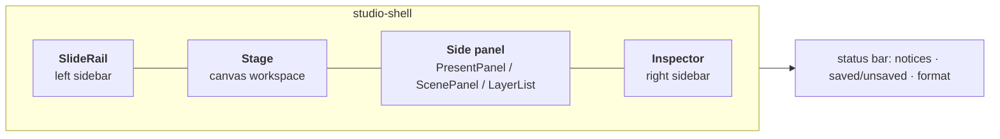

# Human interaction

This page describes the Studio editor: what is where on screen, and where a person clicks,
drags and types. It maps to `apps/studio/src/App.tsx` and `components/`.

```bash
uv run xds open                          # opens with the project browser
uv run xds open ~/xd-projects/my-project
```

This starts the API (`8765`) and the Vite dev UI (`5173`) and opens a browser tab. The session
ends when you stop `xds open`. Headless commands (`xds audit`, `xds export`) run their own
process and never interfere with an open editor.

---

## 1. Screen layout



### 1.1 Left sidebar: `SlideRail`

| Zone | Contents | Actions |
| --- | --- | --- |
| Heading | "Slides", count | **`+`** add slide |
| Slide list | thumbnail, name, finding count badge | click to activate; drag to reorder; trash to delete (not the last slide) |
| Audit | `AuditPanel`: errors/warnings/info counts and the findings list | **Run audit**; click a finding to select its node and zoom to it |
| Format | `FormatSelect`: grouped presets (Social / Video / Print / Custom) | pick a preset (the list is searchable), or **Custom…** and type the size |
| Toolbar | Open project, Search, Export PNG, **Undo**, **Redo**, Save | see shortcuts |

### 1.2 Center: the Stage

- **Canvas toolbar.** The mode switcher (`Present`, then the layers front → back, following
  `layerOrder`). In 3D mode it also has **Move / Rotate / Scale** and **World / Local**. In every
  mode except Present it has **Snap** and **Guides**.
- **Zoom control**: `−` / percentage / `+`, floating at the canvas's bottom-right corner (it stays
  put while a zoomed-in canvas scrolls). Click the percentage to fit the slide to the window.
- **The canvas**: the same `SlideStage` the export renders, so what you see is what is exported.
  Clicking empty canvas clears the selection.
- **Guides** (`G`): the margin, the platform safe zones (hatched), the `u` spacing grid, and the
  third lines. Snapping uses the margin, the grid, other blocks' edges and centers, and the
  thirds.
- **Audit overlay**: after an audit, each finding is drawn on the canvas as an outlined region
  in its severity color. Hovering shows the message and the fix.

### 1.3 Side panel

| Mode | Panel | Contents |
| --- | --- | --- |
| Present | `PresentPanel` | **Layers** (the stack front → back) and the **Exports** list |
| 3D | `ScenePanel` | the slide's 3D objects (select, hide, lock, remove from slide); **+ Add model…** (**Library**: the device models that ship with xds, or **From file…**), **+ Add shape…** |
| Text / 2D / Background | `LayerList` | the layer's nodes; **+ New text…** / **+ New image…** / **+ New background…** |

**Layers (Present).** Each row is one layer:

- **drag handle** (left): drag a row onto another to move the layer to that position. This
  reorders `layerOrder` and is saved;
- **eye** (right): hides the layer **on the canvas only**, so you can see and work on what's under
  it. Its nodes can't be clicked while it's hidden. This is a view setting: it is never saved, and
  renders and exports always include every layer. A hidden layer's row is dimmed and struck
  through;
- **double-click** the row to switch to that layer's mode.

**Node rows (Text / 2D / Background / 3D lists)**, front → back: a **drag handle** to reorder within
the layer, the node's name, an **eye** that hides the node (saved: `hidden` in `project.json`, so
it is left out of renders and exports too), and a **lock** that stops canvas edits (editor only,
not saved). When a row is selected it also shows **bring forward**, **send backward** and
**delete**. Click to select, `Shift + click` to add to the selection.

### 1.4 Right sidebar: `Inspector`

| Mode | Inspector | What you edit |
| --- | --- | --- |
| Present | `BrandInspector` | colors, type roles, project default lighting |
| 3D | `SceneInspector` | the selected object's pose; the slide's **Camera** and **Lighting** |
| Text / 2D / Background | `TransformInspector` + `TypeInspector` / `ImageInspector` / `GroundInspector` | the selected node |

Slides are renamed in the slide rail (double-click the name). A slide has no page color: its
background is its back Background node (see *Add a background*).

### 1.5 Controls

Every inspector uses the same two kinds of field.

**Dropdowns.** Click to open the list; the current value has a check mark. A short list opens as a
plain list. A list long enough to scroll (more than 11 rows, counting group headings such as
Social / Video / Print) turns the box into a **search field** while it's open: type to filter by
name, description or group. Keyboard: `↑`/`↓` move, `Enter` picks, `Escape` closes (without
clearing the canvas selection). The list opens upward near the bottom of the window and grows
leftward near its right edge. Brand color pickers are the same control, with swatches and hex
codes.

**Number fields.**

- **Drag** anywhere on the field to scrub the value (one undo step per drag). A **click** without
  dragging puts the cursor in it to type; `Enter` or clicking away commits, `Escape` cancels.
- A field with a **minimum and maximum** (opacity, weight, field of view, light elevation and
  brightness, design params, …) shows a thin **fill bar** along its bottom edge. Dragging across
  the field's width sweeps the whole range, and the fill follows the pointer; hold `Alt` for fine
  steps. The bar is grey when the value is inherited (shown as a placeholder).
- A field without a range moves one step per 2 px of drag (`Shift` ×10, `Alt` ×0.1).
- While a field is focused, `↑`/`↓` and the **mouse wheel** step it (`Shift` ×10). The wheel only
  acts on a focused field, so scrolling the panel never changes a value by accident.
- A field with a **guide range** (type sizes, line height, frame height, …) turns **amber** when the
  value is outside it, and most show the range in muted text below (for example `54–97`).

### 1.6 `CommandPalette` (⌘K / Ctrl+K)

Filter and `Enter` to run: Open project…, New project…, Add slide, Save, Run audit, Export, Toggle
guides, Switch to Text / 2D / 3D / Background, Go to slide N, Apply lighting look…, Add
background design….

---

## 2. Modes

A mode is `present` (the read-only composite) or one of the four layer ids. **Text**, **2D**,
**3D** and **Background** are labels for `type`, `image`, `render` and `ground`.

| Mode | Key | Editable layer | Side panel | Inspector |
| --- | --- | --- | --- | --- |
| **Present** | `1` | none (read-only) | PresentPanel | BrandInspector |
| **Text** | `2` | `type` | LayerList | TypeInspector |
| **2D** | `3` | `image` | LayerList | ImageInspector |
| **3D** | `4` | `render` | ScenePanel | SceneInspector |
| **Background** | `5` | `ground` | LayerList | GroundInspector |

All layers are visible unless you hide one with its eye in **Layers** (a view setting). The mode
decides which one you can edit. Store actions reject an
edit whose node layer doesn't match the mode, so this is enforced, not just hidden.

---

## 3. Keyboard and mouse

Shortcuts are ignored while typing in a field.

| Shortcut | Action |
| --- | --- |
| `Cmd/Ctrl + S` | Save |
| `Cmd/Ctrl + Z` / `Shift + Cmd/Ctrl + Z` | Undo / redo |
| `Cmd/Ctrl + K` | Command palette |
| `Cmd/Ctrl + O` | Open project |
| `1`–`5` | Present / Text / 2D / 3D / Background |
| `A` | Run audit |
| `G` | Toggle guides |
| `Delete` / `Backspace` | Delete the selection (respects locks) |
| `Shift + click` | Add to / remove from the selection |
| `Cmd/Ctrl + A` | Select all nodes in the current layer |
| `Cmd/Ctrl + D` | Duplicate the selection |
| `Escape` | Close palette, clear selection |
| arrows | Nudge: 2D by 1 px (`Shift`: `u`); 3D by 1 cm (`Shift`: 10 cm) |

In the 3D viewport:

| Gesture | Effect |
| --- | --- |
| left-drag | orbit (camera `yaw` / `pitch`) |
| right-drag | pan (camera `x` / `y`: where the product sits on the canvas) |
| scroll | zoom (camera `height`: how big the product is) |
| **`L` + drag** | swing the light: horizontal = `angle`, vertical = `elevation` |
| drag a gizmo | move / rotate / scale the selected object on this slide |

Clicking any part of a model selects the **whole model**. The editor never moves a model's
individual parts. Articulation (`parts`, `animation`) and device screens are set in the file by
an agent, and the editor displays them and keeps them unchanged when you save.

### 3.1 Selection

- **Multi-select** works within the current mode's layer: `Shift + click`, drag a marquee from
  empty canvas, or `Cmd/Ctrl + A`. In 3D mode, `Shift + click` selects several objects, and the gizmo
  moves them together around their shared center.
- With several 2D nodes selected, the inspector shows the fields they share (mixed values show
  as `—`), and the toolbar adds **Align** (left, center, right, top, middle, bottom) and
  **Distribute** (equal gaps, or gaps snapped to the spacing unit `u`).
- **Selection persists.** Selection is stored as node ids, and editing never changes an id, so
  the edited node stays selected after a drag, an inspector change, undo/redo, save, or a reload
  from disk. It clears only when the node no longer exists, on `Escape`, on a click on empty
  canvas, or when you switch to a mode whose layer the node isn't in.
- **Undo/redo** (`Cmd/Ctrl + Z`, `Shift + Cmd/Ctrl + Z`) steps through every completed edit (one
  step per drag or field change) and restores the selection that went with it.

---

## 4. Walkthroughs

### Create a project

In the editor: `Cmd/Ctrl + O` → **New project** tab (or the palette's *New project…*). Enter a
name, a folder (default `~/xd-projects/<name>`) and a format, then **Create**. The new project
opens right away.

From a terminal: `uv run xds init ~/xd-projects/launch --name "Launch" --format instagram-portrait`.

The scaffold has one blank slide, an empty scene, a one-color brand, and an `AGENTS.md` that tells
an AI agent how to work in the project. Nothing is pre-designed.

### Open a project

`Cmd/Ctrl + O`, the toolbar folder icon, or the palette. The browser lists projects in
`~/xd-projects/` with an **Active** badge. **Browse…** opens the macOS folder picker. If you
have unsaved edits, it warns before switching. A project made with an older XDS (its badge says
*needs migrate*) opens on a **This project needs migrating** screen: **Migrate project** upgrades
it, the same as `xds migrate`, keeping a backup of the old files in `.migrate-backup/`. If it
can't, the screen says why and changes nothing.

### Add text

1. Press `2` (Text). Declare a role first in **Present → Brand → Typography** if none exist; pick
   its **level** (display, headline, …) and the size defaults from the guide.
2. **+ New text…** → choose a role. The block is placed inside the margin.
3. Drag it on the canvas, or type values in the inspector. Edges snap to the margin, the grid and
   other blocks.

### Add a background

There is no page color: the Background layer paints the whole canvas. Every slide's back
Background node covers it (box 0/0/100/100). New projects start with the `solid` design (one
color), and a new slide starts with a copy of the previous slide's background. The audit reports
`UNCOVERED_CANVAS` for a slide where nothing covers the canvas.

1. To change a slide's background, press `5` (Background), select its background node, and change
   its design or knobs. **+ New background…** adds another design on top: pick a project design,
   or **From starters…** (solid, sweep, spotlight, aurora, …), which copies the file into
   `designs/`.
2. The `GroundInspector` shows one control per design param (number field, brand-color picker,
   select, checkbox, text) and the design's variants.

### Add a 3D model

1. Press `4` (3D) → **+ Add model…**:
   - **Library** lists the device models that ship with xds (iPhone 17 Pro, MacBook Pro 14″). The
     project references the model instead of copying it; adding it again on another slide reuses
     the same object.
   - **From file…** takes a `.glb`, `.gltf` or `.dae` (or drop one on the canvas). This runs the
     same conversion and check as `xds model add` and shows any convention warnings (units,
     origin, size).
2. The model appears framed and lit with no further steps.
3. Place it on the canvas with **right-drag** (position) and **scroll** (size), or type
   `x`, `y`, `height` under **Camera**. **Left-drag** changes the viewing angle.
4. Use the gizmo or the pose fields to move or rotate the object itself, e.g. to tilt a bottle.
   These changes apply to this slide only.
5. If the model has articulated parts or a device screen, the inspector lists them read-only (for
   example *Lid: rotated −15°*, *Screen: app-home*), with **Open screen file** to view the HTML.

### Light the product

You usually don't need to do anything. To change it, open **Lighting** in the 3D inspector:

- **Look**: four thumbnails (Softbox, Contrast, Rim, Bright), rendered with your model.
- **Angle / Elevation**: a dial and a number field (0–80°, with a fill bar), or `L` + drag in the
  viewport.
- **Shadow**: Contact · Soft · None.
- **Brightness**: a number field, −1…+1 stop (EV), with a fill bar.
- **Tint**: optional brand color for reflections.

The settings apply to this slide. **Use for all slides** writes them to the project default.

### Edit the brand

In Present mode the inspector shows `BrandInspector`:

- **Colors**: swatches with names and hex codes; add, delete.
- **Typography**: one card per role, in this order: **Font**; **Size range**, the level with its
  px range for this format (for example *caption · 28–35 px*); **Weight** and **Size**; **Color**.
  The size range is the level the audit checks the size against. Size turns amber outside it. The
  header has **+** (add a role) and a **download** button: **Fetch a font from Fontshare…**, which
  downloads the family once into the xds font library and makes it available to the project.
- **Default lighting**: the project's lighting, which slides override.

### Choose the format

Pick a preset in the rail's **Format** selector, or **Custom…**. Boxes are percentages, so the
layout reflows. Type sizes without a pinned `size` follow the new bands. Run the audit afterwards,
because a format change often creates new findings (for example, story safe zones).

### Run the audit

Press `A`, click **Run audit**, or use the palette. Unsaved edits are saved first (the audit reads
the file). The progress line names each slide and step. Findings appear in the rail and as an
overlay on the canvas. Click one to select its node. To accept a finding as deliberate, choose
**Mark as intentional…** on it and give a reason. This writes an exception into the source
([design rules §7](./design-rules.md#7-deliberate-exceptions)).

### Export PNG

Toolbar **Export**. You must save first. Export runs the audit (reusing it when current) and
stops on open errors, listing them. **Export anyway** forces it and records that in
`export.json`. Finished exports appear in the Present panel with a download link per slide.

### Save and external changes

`Cmd/Ctrl + S` saves the whole project in one atomic write. When an agent (or anything else)
changes the project files, the editor reloads them immediately: the file on disk is the truth.
Unsaved edits in the editor are replaced, and a notice says so. Selection stays on anything that
still exists.

---

## 5. Feedback surfaces

| Surface | Where | Shows |
| --- | --- | --- |
| Notices | status bar | latest info/success/warning/error, dismissible |
| Saved state | status bar | "Saved" or "Unsaved changes" |
| Audit panel | left rail | counts and the findings list |
| Audit overlay | canvas | finding regions with message and fix on hover |
| Slide badges | slide list | per-slide open error/warning counts |
| Guide ranges | inspectors | amber fields outside the recommended range, the range in muted text below most of them, and the fill bar on bounded fields |
| Migration screen | whole window | an older project that needs `xds migrate`, with a **Migrate project** button |
| Exports | Present panel | progress per slide and step; finished files with links |

Closing the tab with unsaved edits triggers the browser's `beforeunload` prompt.
